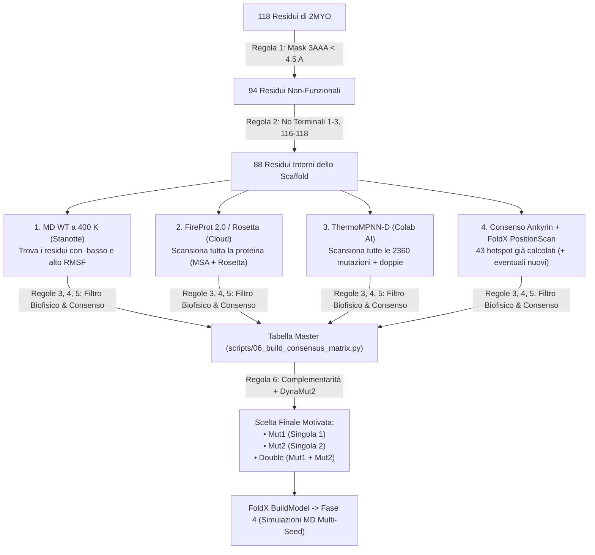

# 🎯 MUTATION_SELECTION.md — Criteri Motivati e Processo Logico per la Scelta delle Mutazioni

**Progetto:** Biomolecular Modelling Laboratory (2026) — Team #10 (Oleg Nedina & Alessia Rigoni)  
**Target:** Myotrophin (`2MYO`, 118 amminoacidi)  
**Regola Fondamentale ([`AGENTS.md`](file:///home/olly/UNI/BioMolEng2026/laboratorio/BML/AGENTS.md)):** *Zero scelte arbitrarie. Ogni inclusione o esclusione di un residuo e ogni scelta di mutazione deve avere una motivazione biofisica, strutturale o statistica documentata.*

---

## 1. ❓ Chiarimento Fondamentale: Da Dove Veniva la Lista Provvisoria e Perché NON È Ancora la Scelta Finale?

È importantissimo distinguere **cosa abbiamo fatto finora** da **come sceglieremo davvero i mutanti finali**:

1. **Cosa sono le 43 posizioni che abbiamo già passato a FoldX (`position_scan_hotspots.cfg`)?**  
   Erano un **pre-screening statico iniziale** ricavato leggendo due soli dati strutturali già presenti nel PDB:
   - I **35 residui** che nella struttura NMR originale `2MYO.pdb` (`REMARK 500`, righe 126–160) hanno angoli di Ramachandran $(\phi, \psi)$ distorti/fuori regione.
   - Le **10 posizioni** dei 4 Ankyrin Repeats che violano la sequenza consenso universale degli Ankyrin Repeats (*Mosavi et al., PNAS 2002*, es. `L73`, `K94`, `P64`, `L105`, `K37`, `H68`, `V81`, `A59`, `E26`, `T103`).

2. **E le altre 45 posizioni interne modificabili (su 88 totali) perché NON le avevamo passate nella prima run di FoldX?**  
   Su `118` amminoacidi totali, tolti i `24` della Functional Mask e i `6` terminali (`1–3` e `116–118`), restano **88 posizioni interne modificabili** (`43` scansionate + **`45` non ancora scansionate**).  
   Nella prima passata quelle **45 posizioni** erano state lasciate fuori per **due motivi precisi**:
   - **Motivo Strutturale/Evolutivo:** Molte di quelle 45 posizioni erano **già identiche al Consenso Ankyrin** (es. i pilastri del core idrofobico e dei turn canonici: `G13, L15, V18, A23, G25, L39, A42, A43, G46, E49, I50, E52, L55, L56, G58, I61, A63, D65, S74, A75, G79, L86, G98, L102`) **e** avevano angoli di Ramachandran $(\phi, \psi)$ già regolari nel `REMARK 500` di `2MYO.pdb`.
   - **Motivo Computazionale (Single-Core):** Poiché FoldX gira su 1 solo core (~35 secondi a posizione), fare tutte le 88 posizioni in serie su un unico processo avrebbe richiesto oltre 50 minuti consecutivi.
   - **⚠️ PERCHÉ PERÒ NON POSSIAMO IGNORARE QUELLE 45 POSIZIONI?**  
     Un residuo che ha angoli di Ramachandran regolari a `297 K` nel PDB statico **può comunque cedere ad alta temperatura (`400 K`) durante la Dinamica Molecolare** (basta guardare `LEU 51`, `ILE 50`, `SER 82` o `LEU 102` che già nello smoke test mostravano $\langle Q_i \rangle$ bassi!), oppure può offrire un'ottima mutazione stabilizzante di superficie o di core individuata da **FireProt/Rosetta** o **ThermoMPNN**.  
     👉 **Soluzione per avere Copertura al 100% (`88 su 88` posizioni, zero punti ciechi):** Sfruttando gli **8 core della tua CPU in parallelo** (8 processi FoldX da 5–6 posizioni ciascuno con [`scripts/04b_run_remaining_foldx_parallel.sh`](file:///home/olly/UNI/BioMolEng2026/laboratorio/BML/scripts/04b_run_remaining_foldx_parallel.sh)), possiamo scansionare **tutte le 45 posizioni mancanti in soli ~3–4 minuti**! Così avremo il $\Delta\Delta G_{\text{FoldX}}$ per **tutte le 88 posizioni modificabili della proteina (100% dello scaffold)**.

3. **Perché NON basta un solo tool ma uniamo MD a 400 K, FoldX (su tutte le 88 posizioni), FireProt/Rosetta e ThermoMPNN?**  
   - Perché **FoldX da solo vede solo il PDB statico** e può sovrastimare mutazioni che nella realtà bloccano i loop o non toccano i veri punti deboli termici.
   - Perché **la Dinamica Molecolare del Wild-Type a `400 K`** (che gira stanotte), **FireProt 2.0 (Rosetta + MSA)** e **ThermoMPNN** analizzano **TUTTA la proteina intera (`1..118`) senza alcuna lista pre-impostata**!
   - *(Nota: L'unico motivo per cui avevamo creato il file `dynamut2_mutations_list.txt` è che il sito web di DynaMut2 non accetta una proteina intera "alla cieca", ma chiede obbligatoriamente un elenco di mutazioni specifiche da testare).*

👉 **Conclusione:** La scelta definitiva dei nostri **2 mutanti singoli (`Mut1`, `Mut2`)** e del **Doppio Mutante (`Double`)** verrà fatta **SOLO DOPO** aver unito i risultati di:
1. **MD del Wild-Type a `400 K`** (chi cede davvero al calore: $\langle Q_i \rangle_{400\text{K}}$ e RMSF),
2. **FireProt 2.0 / Rosetta** (chi è favorito dall'evoluzione e dal *rotamer packing* di Rosetta su tutta la proteina),
3. **ThermoMPNN** (chi è favorito dalla rete neurale su tutta la proteina),
4. **Consenso Ankyrin (`Mosavi 2002`)**,
5. **FoldX 5 (`PositionScan` + Energy Breakdown)** e **DynaMut2**.

*(Se la MD a `400 K`, Rosetta/FireProt o ThermoMPNN individueranno una posizione promettente fuori dalle 43 già passate a FoldX, lanceremo `PositionScan` di FoldX anche su quella posizione in 30 secondi!).*

---

## 2. 🛠️ I Tool Utilizzati (Descrizione Veloce & Perché Li Usiamo Insieme)

Non usiamo un solo tool perché ogni metodo ha un "punto cieco". Usandoli insieme eliminiamo i falsi positivi:

| Tool | Cosa fa (in 2 righe) | Input che gli diamo | Perché ci serve (Cosa aggiunge agli altri) |
| :--- | :--- | :--- | :--- |
| **1. NAMD 3 + VMD (`wt_400K`)** | Simula la proteina in acqua a `400 K` e misura la frazione di contatti nativi conservati per ogni residuo ($\langle Q_i \rangle_{400\text{K}}$) e l'RMSF. | Tutta la proteina solvatata (`1..118`) | **Trova il problema reale:** ci dice quali amminoacidi perdono gli agganci quando la temperatura sale (*Bekker et al., 2019*). |
| **2. Consenso Ankyrin (`Mosavi 2002`)** | Allinea `ANK1–4` di `2MYO` contro il "mattoncino Ankyrin ideale" ricavato da centinaia di proteine Ankyrin. | Tutta la sequenza (`1..118`) | **Guida architetturale:** mostra dove la Myotrophin naturale ha un amminoacido "sbagliato" rispetto al modulo Ankyrin canonico. |
| **3. FireProt 2.0 (include Rosetta + MSA)** | Allinea tutte le sequenze omologhe naturali (MSA) e calcola il $\Delta\Delta G$ con **Rosetta** (campionamento Monte Carlo delle catene laterali) e FoldX. | **Tutta la proteina** (`2MYO_Repair.pdb`) | **Doppio controllo Fisico + Evolutivo:** Rosetta è molto più severo di FoldX sugli ingombri sterici nel core idrofobico. |
| **4. ThermoMPNN-D** | Rete neurale Graph-based (`Lecture05`) addestrata su centinaia di migliaia di $\Delta\Delta G$ sperimentali di melting. | **Tutta la proteina** (`2MYO_Repair.pdb`) | **Scansione totale AI:** in 15 secondi valuta tutte le $118 \times 20 = 2.360$ mutazioni singole + le coppie di doppi mutanti. |
| **5. FoldX 5 (`PositionScan` & `BuildModel`)** | Calcola $\Delta\Delta G_{\text{FoldX}}$ scomposto nei singoli termini fisici (Van der Waals, Solvatazione, H-bond, Clash) e costruisce il PDB 3D del mutante. | `2MYO_Repair.pdb` + posizioni candidate | **Tool ufficiale del corso:** ci dà la scomposizione energetica esatta e genera i file `.pdb` mutati per la Fase 4. |
| **6. DynaMut2** | Calcola l'effetto della mutazione sulle vibrazioni armoniche della struttura (*Normal Mode Analysis*, $\Delta\Delta G_{\text{NMA}}$). | `2MYO_Repair.pdb` + shortlist delle migliori mutazioni | **Controllo meccanico:** verifica che la mutazione non introduca rigidità o flessibilità anomale nello scheletro. |

---

## 3. ⚖️ Le 6 Regole Motivate di Selezione (Come Filtriamo da 118 Posizioni a `Mut1`, `Mut2` e `Double`)

Ogni scelta nel nostro imbuto decisionale segue **6 regole tassative e motivate**:

### Regola 1 — Esclusione dei 24 Residui della Functional Mask (`118` $\rightarrow$ `94` residui)
- **Residui esclusi:** `4, 5, 7, 8, 9, 11, 12, 14, 16, 17, 34, 36, 41, 44, 45, 47, 66, 67, 69, 77, 78, 80, 99, 100`.
- **Motivazione oggettiva:** Sono i 24 amminoacidi che nel complesso cristallografico [`3AAA`](file:///home/olly/UNI/BioMolEng2026/laboratorio/BML/01_structures/raw/3AAA_complex_ref.pdb) hanno atomi pesanti a distanza **$< 4.5\text{ Å}$** dal bersaglio biologico (*Actin-Capping Protein*, inclusa la triade `TRP 8, ASP 44, GLU 78`, *Takeda et al., 2010*). Mutarli altererebbe l'affinità di legame e la funzione biologica della Myotrophin ([`Laboratory_Project_2026.pdf`](file:///home/olly/UNI/BioMolEng2026/laboratorio/Laboratory_Project_2026.pdf), Slide 7 & 19).

### Regola 2 — Esclusione delle Estremità N- e C-Terminali Libere (`94` $\rightarrow$ `88` residui interni)
- **Residui esclusi:** `1, 2, 3` (N-terminale) e `116, 117, 118` (C-terminale).
- **Motivazione oggettiva:** Le prime e ultime 3 posizioni sporgono liberamente nel solvente e fluttuano per natura termica senza contribuire alla barriera cooperativa di unfolding del solenoide Ankyrin (*Bekker et al., 2019*).

### Regola 3 — Filtro di Sanità Biofisica (Scarto di Artefatti Chimici di FoldX)
Anche se FoldX assegna un $\Delta\Delta G < 0$, **scartiamo sempre**:
1. **Mutazioni verso Cisteina (`-> CYS`, es. `T103C`, `T108C`):**  
   *Motivazione:* `2MYO` è una proteina intracellulare priva di ponti disolfuro. Introdurre un gruppo tiolico ($-\text{SH}$) libero in più espone la proteina a ossidazione e aggregazione inter-molecolare.
2. **Mutazioni verso Prolina o Glicina (`-> PRO`, `-> GLY`) all'interno delle $\alpha$-eliche (`HELIX 1–8`):**  
   *Motivazione:* La Prolina manca dell'idrogeno ammidico ($\text{N-H}$) necessario per i legami a idrogeno $i \to i+4$ dell'$\alpha$-elica e piega l'elica di ~30° (*helix breaker*), mentre la Glicina aumenta l'entropia di unfolding dello stato denaturato. Prolina e Glicina sono ammesse **solo nei loop/turn** (es. posizione 1 del $\beta$-turn o posizione 25 del loop `GADVNA` come `A59G` e `H68G`).
3. **Mutazioni che irrigidiscono artificialmente un loop flessibile con una seconda Prolina adiacente (es. `D60P` vicino a `P64`):**  
   *Motivazione:* FoldX premia le Proline perché abbassano il termine empirico di entropia di mainchain ($\Delta S_{\text{mc}}$), ma mettere due Proline nello stesso loop corto (`D60P` + `P64`) può bloccare la geometria inter-repeat durante la dinamica molecolare a `400 K` (verificheremo sempre con **Rosetta/FireProt** e **ThermoMPNN** se una sostituzione come `D60L` o `A59G` è preferita rispetto a `D60P`).

### Regola 4 — Motivazione Dinamica dalla MD del Wild-Type a `400 K` ($\langle Q_i \rangle_{400\text{K}}$ e RMSF)
- **Criterio:** La posizione scelta per la mutazione deve:
  - Trovarsi in un residuo che perde contatti nativi ad alta temperatura (**$\langle Q_i \rangle_{400\text{K}} < 0.60$** o nella fascia debole $\langle Q_i \rangle < 0.72$), **oppure**
  - Formare contatti inter-repeat / intra-repeat diretti ($< 4.5\text{ Å}$) che "ancorano" una regione ad alto RMSF / basso $Q$ emersa dalla simulazione a `400 K`.
- **Motivazione oggettiva:** Stabilizzare un punto già iper-rigido ($\langle Q_i \rangle > 0.90$) non impedisce alla proteina di srotolarsi dal suo punto più debole (*anello debole della catena*, *Bekker et al., 2019*; *Lowe & Itzhaki, PNAS 2007*).

### Regola 5 — Convergenza Multi-Tool ($\Delta\Delta G$ Concorde + Meccanismo Chimico-Fisico Chiaro)
- **Criterio:** Una mutazione entra nella rosa finale solo se:
  1. Ha **$\Delta\Delta G_{\text{FoldX}} < -1.0\text{ kcal/mol}$** con una causa fisica identificabile nei file `energies_*_2MYO_Repair.txt` (es. guadagno di energia idrofobica/Van der Waals $\Delta E_{\text{VdW+SolvH}} < -1.0\text{ kcal/mol}$, rilascio di clash torsionale $\Delta E_{\text{Clash}} < -1.0\text{ kcal/mol}$, o nuovi H-bond $\Delta E_{\text{HBond}} < -0.5\text{ kcal/mol}$).
  2. È **confermata come stabilizzante ($\Delta\Delta G < 0$)** da **almeno altri 2 predittori indipendenti** tra **FireProt 2.0 / Rosetta**, **ThermoMPNN-D**, **DynaMut2** e **Consenso Ankyrin**.

### Regola 6 — Complementarità Spaziale tra `Mut1` e `Mut2` per il Doppio Mutante (`Mut1 + Mut2`)
- **Criterio:** Scegliamo `Mut1` e `Mut2` in due posizioni **non adiacenti** (preferibilmente in due repeat o interfacce distinte, es. una in `ANK2` e una in `ANK3`/`ANK4`, oppure una che ottimizza il loop inter-repeat e una che rinforza il core idrofobico).
- **Motivazione oggettiva:** Se `Mut1` e `Mut2` fossero attaccate nella stessa tasca, le due nuove catene laterali rischierebbero di urtarsi tra loro (*epistasi negativa*). Scegliendole in due punti strategici complementari del solenoide Ankyrin, massimizziamo la probabilità di ottenere **additività o sinergia cooperativa** nel Doppio Mutante (`Mut1 + Mut2`), che verificheremo esplicitamente con `BuildModel` di FoldX e con `ThermoMPNN-D` prima di lanciare la Fase 4!

---

## 4. 🔄 Flusso Operativo Esatto per Applicare Queste Regole (Cosa Facciamo Adesso vs Domani)

### Cosa significa in pratica per te adesso?
1. **Non abbiamo ancora bloccato la scelta finale dei mutanti!** Quello che c'è ora in `03_mutations/foldx_top_mutations.txt` è solo il risultato grezzo del **ramo 4 (`FoldX PositionScan`)**.
2. **Adesso (in parallelo tra Oleg e Alessia — vedi [`ROAD_PER_ALE/01_GUIDA_OPERATIVA_ALESSIA.md`](file:///home/olly/UNI/BioMolEng2026/laboratorio/BML/ROAD_PER_ALE/01_GUIDA_OPERATIVA_ALESSIA.md) e [`ROAD_PER_ALE/02_LAVORO_OLEG_E_UNIONE_DATI.md`](file:///home/olly/UNI/BioMolEng2026/laboratorio/BML/ROAD_PER_ALE/02_LAVORO_OLEG_E_UNIONE_DATI.md))** facciamo partire tutti i rami indipendenti su **`03_mutations/2MYO_Repair.pdb`**:
   - **FireProt 2.0 (Rosetta + Evoluzione):** [https://loschmidt.chemi.muni.cz/fireprot/](https://loschmidt.chemi.muni.cz/fireprot/)
   - **ThermoMPNN-D (AI Singole + Doppie):** [Colab ThermoMPNN-D](https://colab.research.google.com/github/Kuhlman-Lab/ThermoMPNN-D/blob/main/ThermoMPNN-D.ipynb)
   - **DynaMut2 (`Run > Single Mutation -> Mutation List`):** [https://biosig.lab.uq.edu.au/dynamut2/](https://biosig.lab.uq.edu.au/dynamut2/)
   - E **stanotte** Oleg fa girare il **ramo 1 (la MD vera del Wild-Type a `300 K` e `400 K`)** con `run_overnight_wt.sh` (dopo aver completato le `88/88` posizioni di FoldX con `04b_run_remaining_foldx_parallel.sh`).
3. **Domani mattina**, con i dati di **MD + FoldX + Rosetta/FireProt + ThermoMPNN + DynaMut2 + Consenso Ankyrin** tutti sul tavolo, compiliamo la tabella finale motivata al 100% secondo le **6 Regole** qui sopra e scegliamo `Mut1`, `Mut2` e `Double`!
