# 🏛️ ROAD4_ROAD5_POLITICA_DI_VALIDAZIONE.md — Politica di Validazione Completa "Research-Grade" (Protocollo Programmatico Passo-Passo)

**Progetto:** Biomolecular Modelling Laboratory (2026) — Team #10 (Oleg Nedina & Alessia Rigoni)  
**Target:** Myotrophin (`2MYO`, 118 aa) — Confronto Controllato (`WT` vs `Mut1` vs `Mut2` vs `Double`)  
**Stato del Documento:** 📋 **FASE PROGRAMMATIVA (Design del Protocollo di Validazione Multi-Livello — Non Applicativa al Momento)**  
**Riferimenti Fondamentali:**
1. *Bekker GJ, Ma B, Kamiya N (2019).* "Thermal stability of single-domain antibodies estimated by molecular dynamics simulations." **Protein Science**, 28(2):429–438 ([PDF nel workspace](file:///home/olly/UNI/BioMolEng2026/laboratorio/Thermal%20stability%20of%20single-domain%20antibodies%20estimated%20by%20molecular%20dynamics%20simulations.pdf)).
2. *Prof. A. Gautieri (2026).* [`Laboratory_Project_2026.pdf`](file:///home/olly/UNI/BioMolEng2026/laboratorio/Laboratory_Project_2026.pdf) (Slide 3, 9–15, 19–23) & [`analysisMD.tcl`](file:///home/olly/UNI/BioMolEng2026/laboratorio/analysisMD.tcl).
3. *Lowe AR, Itzhaki LS (2007).* "Rational redesign of the folding pathway of a modular protein." **PNAS**, 104(8):2679–2684.
4. *Mosavi LK, Minor DL, Peng ZY (2002).* "Consensus-derived structural determinants of the ankyrin repeat motif." **PNAS**, 99(25):16029–16034.
5. *Best RB, Hummer G, Eaton WA (2013).* "Native contacts determine protein folding mechanisms in atomistic simulations." **PNAS**, 110(44):17874–17879 (citato in *Bekker et al., 2019* Ref. 47).

---

## 🎯 1. Filosofia della Politica di Validazione ("Zero Falsi Positivi, Rigore da Pubblicazione")

Come evidenziato nella Slide 17 di [`Laboratory_Project_2026.pdf`](file:///home/olly/UNI/BioMolEng2026/laboratorio/Laboratory_Project_2026.pdf) (*"FoldX predicts an energetic effect. MD tests structural behaviour under chosen conditions"*) e nella Slide 15 (*"4. Matched MD comparison $\rightarrow$ 5. Evidence and decision: Compare Q and supporting observables. If necessary re-iterate"*), un lavoro di ricerca non si limita a "far girare una simulazione e plottare una curva", ma stabilisce **prima dell'esecuzione** una **Politica di Validazione strutturata su 5 Livelli con Criteri di Accettazione/Rifiuto (*Go / No-Go Gates*)**.

```mermaid
flowchart TD
    L1["LIVELLO 1: Validazione Statica Pre-MD (FoldX BuildModel Multi-Run)\n• n=5 run indipendenti con rotameri rilassati\n• Confronto con Matched WT Reference (Slide 19)\n• Test di Additività Energetica ΔΔΔG_epistasi"]
    L2["LIVELLO 2: Protocollo 'Matched Comparison' & Controllo Qualità Topologico\n• Stessa topologia CHARMM36m (HIS40->HSD, HIS67->HSE)\n• Stesso box TIP3P (12 Å) + 0.15 M NaCl (q_tot = 0.0000 e)\n• n=3 Repliche Multi-Seed indipendenti a 400 K per variante"]
    L3["LIVELLO 3: Validazione Primaria alla Bekker et al. (2019 — Table II & S8-S10)\n• Q: hydrophilic-all (r=0.84 con Tm nel paper!)\n• Q: all-all (r=0.79) e Q: hydrophobic-small (r=0.76)\n• Riduzione del numero di residui instabili (<Qi>_400K < 0.60, N_cont >= 30)"]
    L4["LIVELLO 4: Validazione Biofisica Specifica per Ankyrin Repeats (Lowe & Itzhaki 2007)\n• Q risolto per modulo (Q_ANK1..4) e per Interfaccia Inter-Repeat (Q_ANK1-2, 2-3, 3-4)\n• Ciclo Epistatico Dinamico del Doppio Mutante (ΔQ_1+2 vs ΔQ_1 + ΔQ_2)\n• Matrice di Differenza dei Contatti ΔC_ij = <C_ij^Mut> - <C_ij^WT>"]
    L5["LIVELLO 5: Validazione Meccanica & Funzionale (analysisMD.tcl + 3AAA Mask)\n• ΔRMSF_CA per residuo, RMSD backbone, Rgyr, SASA, % Alpha-Helix (STRIDE)\n• Occupancy (%) H-bond chiave (preservazione ponte HIS40-SER74 e HIS67-GLY35)\n• RMSD della Functional Mask (24 residui 3AAA) per provare che il sito attivo resta intatto!"]

    L1 -->|Gate 1 Superato| L2
    L2 -->|Gate 2 Superato| L3
    L3 --> L4
    L4 --> L5
```

---

## 🧱 LIVELLO 1 — Validazione Statica ed Energetica Pre-MD (`FoldX BuildModel` Multi-Run)

**Riferimento:** [`Laboratory_Project_2026.pdf`](file:///home/olly/UNI/BioMolEng2026/laboratorio/Laboratory_Project_2026.pdf) Slide 18–19 (*"BuildModel: Build shortlisted single or combined mutants using matched WT references"*); `Tutorials/foldx_test/build_model/config.cfg`.

### Passo 1.1 — Costruzione Multi-Run (`numberOfRuns=5`) con Riferimenti WT Accoppiati
In FoldX, `PositionScan` esplora rapidamente i rotameri in una singola passata, ma l'ottimizzazione delle catene laterali vicine ha una componente stocastica. Prima di investire decine di ore di CPU in NAMD:
1. Costruiamo in `03_mutations/individual_list.txt` le varianti candidate:
   - Mutante Singolo 1 (`Mut1`, es. `KA37L;`)
   - Mutante Singolo 2 (`Mut2`, es. `TA103L;`)
   - *(Opzionale Singolo 3: `H1SA68G;`)*
   - Doppio Mutante (`Double`, es. `KA37L,TA103L;`)
   - *(Opzionale Combinato Evolutivo: `KA37L,H1SA68G,TA103L;`)*
2. Eseguiamo **`foldx --command=BuildModel --pdb=2MYO_Repair.pdb --mutant-file=individual_list.txt --numberOfRuns=5`**:
   - Per ciascuna variante e per ciascuna delle 5 run ($k = 1\dots 5$), FoldX genera **sia il modello mutato** (`2MYO_Repair_1_<k>.pdb`) **sia il corrispondente riferimento Wild-Type ottimizzato nello stesso identico intorno** (`WT_2MYO_Repair_1_<k>.pdb`, *"matched WT reference"*, Slide 19!).
   - Dal file `Average_2MYO_Repair.fxout` e `Dif_2MYO_Repair.fxout` calcoliamo **Media $\pm$ Deviazione Standard ($\mu \pm \sigma$)** su 5 run di:
     $$\Delta\Delta G_{\text{BuildModel}} = \Delta G_{\text{Mut}} - \Delta G_{\text{WT\_matched}}$$

### Passo 1.2 — Test Statico di Additività vs Epistasi nel Doppio Mutante
Prima ancora della MD, verifichiamo in `Dif_2MYO_Repair.fxout` se le due mutazioni singole nel Doppio Mutante interferiscono tra loro o sono puramente additive:
$$\Delta\Delta\Delta G_{\text{coupling}} = \Delta\Delta G_{\text{Double}} - \left(\Delta\Delta G_{\text{Mut1}} + \Delta\Delta G_{\text{Mut2}}\right)$$
- **Criterio di Superamento (*Gate 1*):**
  1. $\Delta\Delta G_{\text{BuildModel}} < -1.0\text{ kcal/mol}$ con deviazione standard tra le 5 run $\sigma < 0.3\text{ kcal/mol}$ (convergenza rotamerica).
  2. $\Delta\Delta\Delta G_{\text{coupling}} \le +0.2\text{ kcal/mol}$ (assenza di epistasi negativa/scontri sterici tra `Mut1` e `Mut2`) e termine di clash $\Delta E_{\text{VdWClash}} < +0.5\text{ kcal/mol}$.
  3. Ispezione visiva 3D in VMD (`scripts/viz_04_mutations_zoom.tcl`) sovrapponendo `2MYO_Repair_1.pdb` a `WT_2MYO_Repair_1.pdb`.

---

## ⚙️ LIVELLO 2 — Protocollo "Matched Comparison" MD e Controllo di Qualità Topologico

**Riferimento:** [`Laboratory_Project_2026.pdf`](file:///home/olly/UNI/BioMolEng2026/laboratorio/Laboratory_Project_2026.pdf) Slide 3 (*"Controlled computational comparison: Use consistent modelling and MD settings for WT and variants"*), Slide 15 (*"4. Matched MD comparison: Simulate WT and variants with the same protocol and multiple velocity seeds"*), Slide 21 (*Computational Budget*); *Bekker et al. (2019)* Materials & Methods p. 436.

### Passo 2.1 — Costruzione Rigorosamente Identica dei Domini Solvatati (`CHARMM36m`)
Per garantire che ogni differenza osservata in MD dipenda **esclusivamente** dalla mutazione amminoacidica e mai da artefatti di setup ([`AGENTS.md`](file:///home/olly/UNI/BioMolEng2026/laboratorio/BML/AGENTS.md) Sez. 2.B.3):
1. Partendo dal conformero a più bassa energia di `BuildModel` per ciascuna variante (`Mut1`, `Mut2`, `Double`), uno script TCL unico (`scripts/08_build_matched_mutants_charmm36m.tcl`) applica **esattamente gli stessi passaggi di [`scripts/02_build_wt_charmm36m.tcl`](file:///home/olly/UNI/BioMolEng2026/laboratorio/BML/scripts/02_build_wt_charmm36m.tcl)**:
   - Stessa assegnazione tautomerica delle 4 Istidine verificata in Fase 1: **`HIS 40 -> HSD`**, **`HIS 67 -> HSE`**, **`HIS 68 -> HSD`** (o `GLY 68` se mutata), **`HIS 80 -> HSD`**.
   - Stessa rimozione di idrogeni pre-esistenti (`protein and noh`) e ricostruzione con `psfgen` + topologia **`CHARMM36m`** (`common/charmm36/top_all36_prot.rtf`, `par_all36m_prot.prm`, `toppar_water_ions.str`).
   - Stesso protocollo di solvatazione `TIP3P` (`solvate -t 12`) e neutralizzazione/forza ionica fisiologica **`0.15 M NaCl`** (`autoionize -sc 0.15`).
2. **Controllo di Qualità Topologico (*Gate 2*):**
   - Verifica automatica che la carica netta totale del box ionizzato sia esattamente **`0.0000 e`** per tutte le varianti (nota: mutando `LYS 37 (+1) -> LEU (0)`, la carica netta della proteina passa da $-5.00\text{ e}$ a $-6.00\text{ e}$, e `autoionize` bilancia automaticamente con 1 ione $\text{Na}^+$ in più mantenendo la neutralità elettrica esatta per il PME!).

### Passo 2.2 — Disegno Sperimentale Multi-Seed e Budget Computazionale
Seguendo *Bekker et al. (2019)* (p. 433 & p. 435: *"Our results suggest that 400 K is the most productive temperature, and as such we performed our mutation case study only at 400 K... using different random seeds for the initial velocities"*) e la Slide 21 di [`Laboratory_Project_2026.pdf`](file:///home/olly/UNI/BioMolEng2026/laboratorio/Laboratory_Project_2026.pdf):

| Sistema | Temperatura | Repliche Indipendenti (`seed` Maxwell-Boltzmann) | Durata per Replica ($t_{\text{sim}}$) | Tempo Totale Simulato | Tempo Wall-Clock su `namd3 +p8` (`12.68 ns/day`) |
| :--- | :---: | :---: | :---: | :---: | :---: |
| **`WT` (Controllo 300 K)** | `300 K` | `1` (`seed 12345` — *Già completata!*) | `1.5 ns` (`750.000` step) | `1.5 ns` | ✅ `2.8 ore` *(Fatto)* |
| **`WT` (Stress 400 K)** | `400 K` | `3` (`seed 12345` *fatta*, `seed 23456`, `seed 34567`) | `2.5 ns` (`1.250.000` step) | `7.5 ns` | `1` fatta + `2` da fare (`~9.4 ore`) |
| **`Mut1` (`K37L`)** | `400 K` | `3` (`seed 12345`, `seed 23456`, `seed 34567`) | `2.5 ns` (`1.250.000` step) | `7.5 ns` | `3` repliche (`~14.2 ore`) |
| **`Mut2` (`T103L` o `H68G`)** | `400 K` | `3` (`seed 12345`, `seed 23456`, `seed 34567`) | `2.5 ns` (`1.250.000` step) | `7.5 ns` | `3` repliche (`~14.2 ore`) |
| **`Double` (`Mut1 + Mut2`)** | `400 K` | `3` (`seed 12345`, `seed 23456`, `seed 34567`) | `2.5 ns` (`1.250.000` step) | `7.5 ns` | `3` repliche (`~14.2 ore`) |
| **TOTALE CAMPAGNA** | **`300K + 400K`** | **`13` traiettorie totali (`12` a `400 K` + `1` a `300 K`)** | **`2.5 ns` (`400 K`)** | **`31.5 ns`** | **`~52 ore` remanenti (~26h a testa se divise tra Oleg e Alessia!)** |

- **Parametri Fisici Identici in tutti i file `.conf`:**
  - `minimize 1000` (rilassamento iniziale di 1.000 step con coniugato gradiente), seguito da `run 1250000` ($\Delta t = 2.0\text{ fs}$, `rigidBonds all`, `timestep 2.0`).
  - Termostato di Langevin (`langevin on`, `langevinDamping 1.0`, `langevinTemp 400`) e Barostato Nosé-Hoover Langevin Piston a `1.01325 bar` (`useGroupPressure yes`).
  - Elettrostatica full Particle Mesh Ewald (`PME yes`, `PMEGridSpacing 1.0`), cutoff non-bonded `12.0 Å`, `switchdist 10.0 Å`, `pairlistdist 14.0 Å`, salvataggio frame ogni `1.000` step (`2 ps` $\rightarrow$ `1.250` frame per replica).

---

## 📊 LIVELLO 3 — Validazione Primaria secondo il Paper di Riferimento (*Bekker, Ma & Kamiya, 2019*)

**Riferimento:** *Bekker et al. (2019)* — **Figure 2B–C (p. 432)**, **Table II (p. 434: *"4idl Mutant Case Study Stability Statistics with Respect to the Wild Type"*)** e **Tables S1, S8–S10 (pp. 433–434)**.

Nel paper di riferimento del corso, Bekker et al. validano i loro 3 mutanti virtuali dell'anticorpo `4idl` (`R71I`, `N27D`, e il doppio mutante `N27D/R71I`) a `400 K` attraverso **2 metriche primarie** calcolate nella finestra finale equilibrata (ultimi 30% della traiettoria, corrispondenti ai frame `876..1251` su `1252` nelle nostre run da `2.5 ns`):

### Passo 3.1 — Tabella di Confronto Statistico per Classi Chimiche (*Replica Esatta della Table II di Bekker et al., p. 434*)
Bekker et al. dimostrano (Fig. 2B, p. 432 e Discussion p. 435) che non tutti i contatti nativi pesano uguale sulla $T_m$ sperimentale:
1. **`Q: hydrophilic-all`** (contatti tra residui polari/carichi `ASP, GLU, GLN, ASN, ARG, LYS, HIS` e tutti i residui della proteina): ha la **correlazione più alta con la $T_m$ sperimentale ($r = 0.84$)**, perché la rottura della rete di interazioni polari superficiali/inter-loop innesca la penetrazione dell'acqua calda nel core!
2. **`Q: all-all`** (tutti i contatti atomici pesanti `noh` entro $4.5\text{ Å}$): correlazione **$r = 0.79$** con $T_m$.
3. **`Q: hydrophobic-small`** (contatti tra residui idrofobici `PHE, TYR, TRP, LEU, VAL, ILE, MET, CYS, PRO` e piccoli `GLY, ALA, SER, THR`): correlazione **$r = 0.76$** con $T_m$ (misura la tenuta dell'impaccamento del core).

Per i nostri 4 sistemi (`WT`, `Mut1`, `Mut2`, `Double`), calcoleremo su ciascuna delle 3 repliche ($r = 1, 2, 3$) la media temporale nella finestra finale (`1.75–2.50 ns`, frame `876–1251`) e poi la **Media $\pm$ Deviazione Standard tra le 3 repliche ($\mu \pm \sigma$)**, compilando la nostra **Table II**:

| Sistema Computazionale (`400 K`, $n=3$ seed) | Backbone RMSD (Å) [$\mu \pm \sigma$] | $Q$: `hydrophilic-all` ($r=0.84$ in Bekker) [$\mu \pm \sigma$] | $Q$: `all-all` ($r=0.79$ in Bekker) [$\mu \pm \sigma$] | $Q$: `hydrophobic-small` ($r=0.76$ in Bekker) [$\mu \pm \sigma$] | N° Residui Instabili ($\langle Q_i \rangle < 0.60$, $N_0 \ge 30$, no terminali) | $p$-value ($Q_{\text{all}}$ vs WT, Welch $t$-test) |
| :--- | :---: | :---: | :---: | :---: | :---: | :---: |
| **`2MYO` Wild-Type** *(Seed 1 già nota)* | `~6.88 ± ...` | `~0.680 ± ...` | `~0.693 ± ...` | `~0.625 ± ...` | **`34` residui** (`28` nello scaffold + `6` masked) | — (Riferimento) |
| **`Mut1` (`K37L`)** | $<\text{WT}$ | $> 0.680$ | $> 0.693$ | $> 0.625$ | $< 34$ | $p < 0.05$ |
| **`Mut2` (`T103L` / `H68G`)** | $<\text{WT}$ | $> 0.680$ | $> 0.693$ | $> 0.625$ | $< 34$ | $p < 0.05$ |
| **`Double` (`Mut1 + Mut2`)** | $\ll\text{WT}$ | $\gg 0.680$ | $\gg 0.693$ | $\gg 0.625$ | $\ll 34$ | $p < 0.01$ |

### Passo 3.2 — Conteggio e Mappatura dei Residui Localmente Instabili ($\langle Q_i \rangle_{400\text{K}} < 0.60$, *Bekker et al.* pp. 433–434)
Nel caso studio su `4idl` di *Bekker et al.* (p. 433–434, Tables S1 e S8–S10):
- Il Wild-Type `4idl` aveva **`16` residui instabili** ($\langle Q_i \rangle < 0.60$, escludendo i residui con $< 30$ contatti nativi);
- Il mutante singolo `R71I` scendeva a **`13` residui instabili**;
- Il mutante singolo `N27D` scendeva a **`12` residui instabili**;
- Il doppio mutante `N27D/R71I` scendeva a soli **`9` residui instabili** (`-44%` di residui instabili!).

**La nostra applicazione identica su `2MYO`:**
- Nella Replica 1 del Wild-Type a `400 K` ([`02_wt_baseline/unstable_residues_report.txt`](file:///home/olly/UNI/BioMolEng2026/laboratorio/BML/02_wt_baseline/unstable_residues_report.txt)), `2MYO` presenta **`28` residui dello scaffold interno** con $\langle Q_i \rangle_{400\text{K}} < 0.60$ e $N_{\text{cont}}(0) \ge 30$ (distribuiti soprattutto in `ANK2`: `14` residui, `ANK3`: `8` residui, `ANK1`: `10` residui, `ANK4`: `4` residui).
- Per ogni variante calcoleremo il profilo $\langle Q_i \rangle_{400\text{K}}$ mediato sulle 3 repliche e il **differenziale per residuo**:
  $$\Delta\langle Q_i \rangle = \langle Q_i \rangle_{400\text{K}}^{\text{Mut}} - \langle Q_i \rangle_{400\text{K}}^{\text{WT}}$$
  dimostrando quanti residui passano dalla fascia rossa ($\langle Q_i \rangle < 0.60$, *Unstable*) alla fascia stabile ($\langle Q_i \rangle \ge 0.60$).

---

## 🧬 LIVELLO 4 — Validazione Biofisica "Repeat-Resolved" e Ciclo Epistatico (*Lowe & Itzhaki, PNAS 2007*)

Questo livello è il nostro **marchio di fabbrica da lavoro di ricerca**, specifico per l'architettura solenoide a 4 Ankyrin Repeats della Myotrophin:

### Passo 4.1 — Frazione di Contatti Nativi Risolta per Modulo (`Q_ANK1..4`) e per Interfaccia Inter-Repeat (`Q_ANK1-2`, `Q_ANK2-3`, `Q_ANK3-4`)
Oltre ai 4 valori intra-modulo già implementati in [`scripts/03_analyze_wt_baseline.tcl`](file:///home/olly/UNI/BioMolEng2026/laboratorio/BML/scripts/03_analyze_wt_baseline.tcl#L143-L158) (`Q_ANK1` `1–34`, `Q_ANK2` `35–67`, `Q_ANK3` `68–100`, `Q_ANK4` `101–118`), aggiungiamo nella pipeline di validazione il calcolo esplicito dei **contatti nativi di interfaccia tra moduli adiacenti**:
1. **`Q_interface(ANK1–ANK2)`:** `prepareNativeContacts 4.5 $sel_ank1 $sel_ank2`
2. **`Q_interface(ANK2–ANK3)`:** `prepareNativeContacts 4.5 $sel_ank2 $sel_ank3`
3. **`Q_interface(ANK3–ANK4)`:** `prepareNativeContacts 4.5 $sel_ank3 $sel_ank4`

**Cosa ci permette di dimostrare scientificamente (*Lowe & Itzhaki, PNAS 2007*):**
- Ci permette di verificare non solo l'**effetto locale diretto** (es. `K37L` alza `Q_ANK2` e `Q_interface(ANK1–ANK2)`; `T103L` alza `Q_ANK4` e `Q_interface(ANK3–ANK4)`), ma anche la **cooperatività allosterica a lungo raggio**: stabilizzare il C-cap (`ANK4`) con `T103L` rallenta il disaccoppiamento di `ANK3` e `ANK2` grazie alla natura altamente cooperativa del solenoide Ankyrin!

### Passo 4.2 — Ciclo Termodinamico/Cinetico del Doppio Mutante (Additività vs Sinergia Epistatica)
Come fatto da *Bekker et al. (2019)* (p. 434: *"the combination of the two point mutations in the double mutant suggests that the improvements are additive (Table II)"*), definiamo per ogni osservabile $X \in \{Q_{\text{all}}, Q_{\text{phil}}, Q_{\text{ANK2}}, Q_{\text{ANK4}}, N_{\text{unstable}}\}$ il guadagno rispetto al Wild-Type:
$$\Delta X_{\text{Mut1}} = \langle X \rangle_{\text{Mut1}} - \langle X \rangle_{\text{WT}}, \quad \Delta X_{\text{Mut2}} = \langle X \rangle_{\text{Mut2}} - \langle X \rangle_{\text{WT}}, \quad \Delta X_{\text{Double}} = \langle X \rangle_{\text{Double}} - \langle X \rangle_{\text{WT}}$$
e il **termine di accoppiamento epistatico dinamico**:
$$\Delta\Delta X_{\text{epistasi}} = \Delta X_{\text{Double}} - \left(\Delta X_{\text{Mut1}} + \Delta X_{\text{Mut2}}\right)$$
- Se $\Delta\Delta Q_{\text{epistasi}} \approx 0$ (entro l'errore standard $\sqrt{\sigma_1^2 + \sigma_2^2 + \sigma_{12}^2 + \sigma_{\text{WT}}^2}$): **Stabilità Additiva** (come in *Bekker et al., 2019* per `N27D/R71I`).
- Se $\Delta\Delta Q_{\text{epistasi}} > 0$: **Epistasi Positiva / Sinergia Cooperativa** lungo il solenoide Ankyrin!
- Se $\Delta\Delta Q_{\text{epistasi}} < 0$ ma $\Delta Q_{\text{Double}} > \max(\Delta Q_{\text{Mut1}}, \Delta Q_{\text{Mut2}})$: **Additività Sub-Lineare (Saturazione del Fold)**.

### Passo 4.3 — Matrice 2D di Differenza delle Mappe di Contatto ($\Delta C_{ij}$)
Per visualizzare graficamente nelle slide *dove* i mutanti guadagnano contatti rispetto al Wild-Type, calcoliamo la matrice $118 \times 118$ della frequenza media di contatto residuo-residuo nella finestra equilibrata a `400 K`:
$$\Delta C_{ij} = \langle C_{ij}^{\text{Double}} \rangle_{400\text{K}} - \langle C_{ij}^{\text{WT}} \rangle_{400\text{K}} \in [-1, +1]$$
- Le macchie **blu ($\Delta C_{ij} > +0.20$)** sulla heatmap mostreranno a colpo d'occhio i contatti intra- ed inter-repeat salvati dalla denaturazione termica!

---

## 🛠️ LIVELLO 5 — Validazione Meccanica, Secondaria e di Preservazione Funzionale (`analysisMD.tcl` + `3AAA`)

**Riferimento:** [`Laboratory_Project_2026.pdf`](file:///home/olly/UNI/BioMolEng2026/laboratorio/Laboratory_Project_2026.pdf) Slide 15 (*"Compare Q and supporting observables"*), Slide 22 (*"RMSF: local flexibility -> analysisMD.tcl script in webeep"*); [`analysisMD.tcl`](file:///home/olly/UNI/BioMolEng2026/laboratorio/analysisMD.tcl).

Come sottolinea il Prof. Gautieri nella Slide 22 (*"NOTE: flexibility alone does not establish local instability or identify a beneficial mutation"*), il $Q$-value va sempre affiancato dalle **6 osservabili strutturali di `analysisMD.tcl`** più un **test di integrità del sito attivo (`3AAA`)**:

1. **Profilo Differenziale di Flessibilità Locale ($\Delta\text{RMSF}_{C_\alpha}$):**
   - Calcoliamo $\text{RMSF}_{C_\alpha}(i)$ (dopo `pbc wrap` e `measure fit` sul backbone del frame 0, Slide 22) per tutte le repliche e plottiamo:
     $$\Delta\text{RMSF}(i) = \langle \text{RMSF}_{\text{Mut}}(i) \rangle - \langle \text{RMSF}_{\text{WT}}(i) \rangle$$
   - **Verifica attesa:** Abbattimento dei picchi anomali di RMSF a `400 K` intorno al sito mutato (es. regione `35–42` e `58–65` in `ANK2` per `K37L`; regione `91–97` e `101–108` in `ANK3–ANK4` per `T103L`).
2. **Conservazione della Struttura Secondaria (`% Alpha-Helix` via STRIDE, `analysisMD.tcl` righe 110–125):**
   - Nel Wild-Type, la frazione di residui in $\alpha$-elica scende dal `~46%` (`54` residui a `300 K`) a valori inferiori e più fluttuanti a `400 K`. Verifichiamo che i mutanti mantengano una `% Alpha-Helix` statisticamente superiore al WT nella finestra finale a `400 K`.
3. **Compatezza Globale: Raggio di Girazione ($R_g$) e Superficie Accessibile al Solvente ($\text{SASA}$, raggio sonda $1.4\text{ Å}$):**
   - Un mutante più termostabile resiste al rigonfiamento idrodinamico ad alta temperatura, mostrando un **$R_g$ più basso e stabile** (più vicino ai `14.5 Å` fisiologici di `300 K`) e una **$\text{SASA}$ inferiore** (minore esposizione del core idrofobico all'acqua calda).
4. **Analisi Dettagliata dell'Occupancy (%) dei Legami a Idrogeno (`hbonds -type unique`, `analysisMD.tcl` righe 57–62):**
   - Verifichiamo quantitativamente nei file `hbonds_details_*.txt`:
     - Che nel mutante **`K37L`** sparisca il ponte salino parassita `LYS37-NZ -> ASP60-OD1/OD2` (`47.6%` nel WT) e aumenti l'occupancy dei legami a idrogeno canonici dell'elica interna di `ANK2` (`ALA43 -> LEU39` e `ASP44 -> HSD40`, che nel WT a 400 K crollavano al `5.0%` e `0.5%`)!
     - Che nel mutante **`T103L`** aumenti l'occupancy dei legami a idrogeno dell'elica C-cap di `ANK4` (`ALA107 -> LEU102` e `GLU106 -> LEU102`, che nel WT a 400 K crollavano allo `0.16%` e `6.79%`)!
     - Che i due ponti a idrogeno chiave delle istidine scoperti in Fase 1 (**`HSD 40 -> SER 74`** e **`HSE 67 -> GLY 35`**) restino intatti!
5. **Controllo di Integrità Funzionale (*Functional Mask RMSD Check* su `3AAA`):**
   - Calcoliamo l'RMSD a `400 K` ristretto ai soli **24 residui della Functional Mask** (`resid 4 5 7 8 9 11 12 14 16 17 34 36 41 44 45 47 66 67 69 77 78 80 99 100`) rispetto alla geometria di legame con l'Actin-Capping Protein: dimostrare che nei nostri mutanti la faccia concava di legame non si deforma (anzi, è più stabile che nel WT!) chiude il cerchio con il **Learning Objective 1 & 4** ([`Laboratory_Project_2026.pdf`](file:///home/olly/UNI/BioMolEng2026/laboratorio/Laboratory_Project_2026.pdf) Slide 3 & 7)!

---

## 🚦 6. Matrice Finale di Accettazione / Rifiuto ("Go / No-Go Decision Policy", Slide 15)

Alla fine della Fase 5, una variante progettata viene dichiarata **Validata *In Silico*** se supera i seguenti criteri oggettivi:

| Criterio | Metrica Quantitativa | Soglia di Successo (*Go*) | Azione in Caso di Fallimento (*No-Go / Re-iterate*, Slide 15) |
| :--- | :--- | :--- | :--- |
| **1. Stabilità Primaria ($Q$)** | $\Delta Q_{\text{all-all}}$ e $\Delta Q_{\text{hydrophilic-all}}$ a `400 K` ($\mu_{\text{Mut}} - \mu_{\text{WT}}$ su 3 seed) | **$\Delta Q > +0.02$** (con $p < 0.05$ o bande $\mu \pm \sigma$ separate, come in *Bekker et al.* Table II dove $\Delta Q_{\text{single}} = +0.02$ e $\Delta Q_{\text{double}} = +0.04$) | Se una mutazione singola ha $\Delta Q \le 0$, sostituirla con il candidato di riserva già pronto nella Tabella Master (`H68G` o `D93G` o `T108L`). |
| **2. Guarigione dei Punti Deboli** | Numero di residui dello scaffold con $\langle Q_i \rangle_{400\text{K}} < 0.60$ ($N_0 \ge 30$) | **$N_{\text{unstable}}^{\text{Mut}} < N_{\text{unstable}}^{\text{WT}}$** (riduzione netta dei residui instabili, specialmente nel repeat target) | Ispezionare in VMD quale residuo vicino ha perso contatti e verificare eventuali clash sterici locali. |
| **3. Coerenza Meccanica (`analysisMD.tcl`)** | $\Delta\text{RMSF}_{C_\alpha}$ nel repeat mutato, `% Alpha-Helix`, $R_g$ | **$\Delta\text{RMSF} < 0\text{ Å}$** nella regione target e **$\Delta(\%\text{ }\alpha\text{-elica}) \ge 0$** | Se l'RMSF aumenta o l'elica si srotola, la mutazione ha introdotto frustrazione dinamica $\rightarrow$ scartare. |
| **4. Preservazione Funzionale (`3AAA`)** | Integrità dei 24 residui della Functional Mask | Nessun residuo mascherato mutato (`100%` sequenza attiva conservata) e $\text{RMSD}_{\text{Mask}}^{\text{Mut}} \le \text{RMSD}_{\text{Mask}}^{\text{WT}}$ | Tassativo: già garantito a monte dalla Regola 1. |
