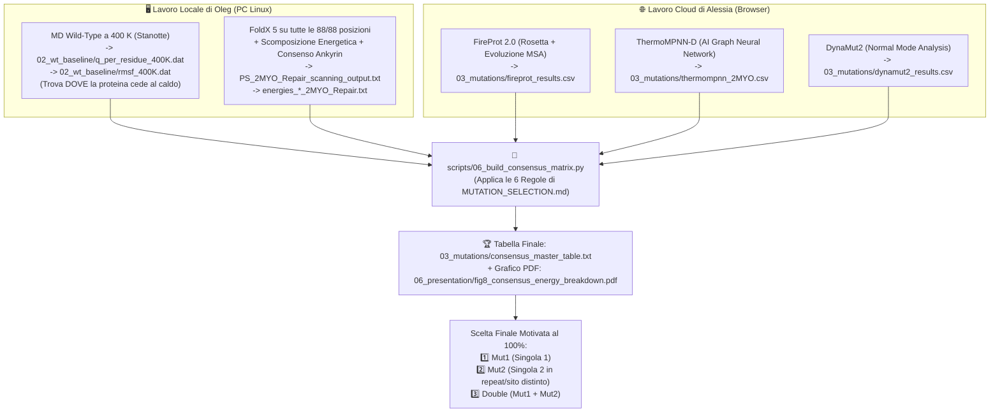

# 🤝 02_LAVORO_OLEG_E_UNIONE_DATI.md — Cosa Sta Facendo Oleg in Locale e Come Uniamo le Scoperte

**Progetto:** Biomolecular Modelling Laboratory (2026) — Team #10 (Oleg Nedina & Alessia Rigoni)  
**Target:** Myotrophin (`2MYO`, 118 amminoacidi)  
**Obiettivo di questo documento:** Spiegare in modo chiaro cosa sta calcolando Oleg sul suo PC e **come domani mattina metteremo insieme i file `.csv` di Alessia con le simulazioni di Oleg** per scegliere i mutanti definitivi (`Mut1`, `Mut2` e `Double`) e andare avanti con la Fase 4.

---

## 🖥️ 1. Cosa Ha Fatto e Cosa Sta Calcolando Oleg in Locale

Mentre Alessia esegue lo screening con i predittori Cloud/AI/Rosetta ([`01_GUIDA_OPERATIVA_ALESSIA.md`](file:///home/olly/UNI/BioMolEng2026/laboratorio/BML/ROAD_PER_ALE/01_GUIDA_OPERATIVA_ALESSIA.md)), Oleg ha preparato ed esegue sul suo PC Linux i calcoli pesanti di **Dinamica Molecolare (NAMD 3 + VMD)** e **FoldX 5**:

### A. Fase 1 — Struttura, Tautomeri, Functional Mask e Scatola d'Acqua (`01_structures/`) [✅ Già Fatto]
1. **Ispezione Chimica di `2MYO.pdb`:** verificata l'assenza di ponti disolfuro tra le 3 Cisteine (`CYS 2, 45, 83`) e assegnati gli stati di protonazione corretti a pH 7.0 per le 4 Istidine (`HIS 40 -> HSD`, `HIS 67 -> HSE`, `HIS 68 -> HSD`, `HIS 80 -> HSD`).
2. **Estrazione della Functional Mask da `3AAA`:** sovrapposta `2MYO` al complesso cristallografico `3AAA` (Myotrophin + Actin-Capping Protein, $\text{RMSD} = 2.365\text{ Å}$) e individuati i **24 amminoacidi a distanza $< 4.5\text{ Å}$ dal recettore** che non devono mai essere mutati.
3. **Costruzione del Sistema Solvatato (`CHARMM36m`):** immersa la proteina in una scatola periodica d'acqua `TIP3P` ($12\text{ Å}$ di margine) con concentrazione salina fisiologica $0.15\text{ M NaCl}$ (`21.461` atomi totali, carica netta esattamente `0.0000 e`).

### B. Fase 3 Locale — Consenso Ankyrin & Scansione Completa `88/88` con FoldX 5 (`03_mutations/`) [✅ Fatto Stasera]
1. **Allineamento al Consenso delle Ankyrin Repeats (*Mosavi et al., PNAS 2002*):**
   - Allineati i 4 repeat (`ANK1–4`) di `2MYO` contro la sequenza ideale di 33 amminoacidi delle Anchirine termostabili (grafico già pronto in [`06_presentation/fig6_ankyrin_consensus_alignment.pdf`](file:///home/olly/UNI/BioMolEng2026/laboratorio/BML/06_presentation/fig6_ankyrin_consensus_alignment.pdf)).
2. **Riparazione (`2MYO_Repair.pdb`) e Scansione `PositionScan` sul 100% dello Scaffold (`88 su 88` posizioni):**
   - Tolti i 24 residui della Functional Mask e i 6 residui delle code terminali (`1–3` e `116–118`), restano **88 posizioni interne modificabili**.
   - Con lo script parallelo a 8 core ([`scripts/04b_run_remaining_foldx_parallel.sh`](file:///home/olly/UNI/BioMolEng2026/laboratorio/BML/scripts/04b_run_remaining_foldx_parallel.sh)), FoldX prova **tutti i 20 amminoacidi su tutte le 88 posizioni** ($88 \times 20 = 1.760$ varianti valutate!).
   - Inoltre, lo script estrae dai file `energies_*_2MYO_Repair.txt` la **scomposizione fisico-chimica esatta** di ogni mutazione:
     - $\Delta E_{\text{VdW+SolvH}}$ (miglioramento dell'impaccamento idrofobico nel core),
     - $\Delta E_{\text{Clash}}$ (rilascio di scontri sterici e tensioni di Ramachandran nei loop),
     - $\Delta E_{\text{HBond}}$ (nuovi legami a idrogeno intramolecolari).

### C. Fase 2 — Simulazione MD Notturna del Wild-Type a `300 K` e `400 K` (`02_wt_baseline/`) [🌙 Gira Stanotte (~7.5 ore)]
Perché simuliamo il Wild-Type in acqua stanotte con `run_overnight_wt.sh`?
- **Run 1 — Controllo a `300 K` ($27^\circ\text{C}$, `1.5 ns`):** verifica che a temperatura ambiente la proteina nativa sia stabile ($\text{RMSD} < 2\text{ Å}$, frazione di contatti nativi $Q \approx 0.90$).
- **Run 2 — Stress Termico a `400 K` ($127^\circ\text{C}$, `2.5 ns`, protocollo *Bekker, Ma & Kamiya 2019*):** l'alta temperatura accelera i moti termici e fa emergere i **"bulloni deboli" della proteina**, cioè:
  1. Quale dei 4 Ankyrin Repeats (`ANK1`, `ANK2`, `ANK3`, `ANK4`) perde più contatti nativi $Q(t)$ ad alta temperatura;
  2. Quali singoli residui $i$ hanno una **frazione media di contatti nativi bassa ($\langle Q_i \rangle_{400\text{K}} < 0.60$ o $< 0.72$)** e un **alto RMSF** (fluttuazione termica).
- Al termine della notte, lo script genera in automatico il report definitivo **`02_wt_baseline/unstable_residues_report.txt`** e i grafici vettoriali `fig5_wt_baseline_plots.pdf` e `fig5b_wt_analysisMD_observables.pdf`.

---

## 🔗 2. Come Mettiamo Insieme le Scoperte di Alessia e quelle di Oleg (Domani Mattina)

Domani mattina avremo tutti i pezzi del puzzle. Non sceglieremo le mutazioni "a occhio", ma facendo girare un unico comando Python ([`scripts/06_build_consensus_matrix.py`](file:///home/olly/UNI/BioMolEng2026/laboratorio/BML/scripts/06_build_consensus_matrix.py)) che unisce automaticamente il lavoro di entrambi:



### Come funziona esattamente l'incrocio tra i dati di Alessia e di Oleg?
Per ogni possibile mutazione fuori dalla Functional Mask:
1. **Oleg (MD `400 K`)** ci dice: *"Questo residuo (o il loop/repeat a cui è agganciato) perde contatti nativi a `400 K` ($\langle Q_i \rangle_{400\text{K}}$ basso / alto RMSF), quindi è un punto strutturalmente vulnerabile che ha bisogno di essere rinforzato"*.
2. **Oleg (FoldX + Consenso Ankyrin)** ci dice: *"Mutando questo residuo (es. `T108L`, `A59G`, `V81L`, `T103F`, `H68G`, `P64V`, `K37L`), FoldX prevede un forte guadagno di stabilità ($\Delta\Delta G_{\text{FoldX}} < -1.5\text{ kcal/mol}$) grazie a un meccanismo fisico preciso (miglior impaccamento idrofobico $\Delta E_{\text{VdW+SolvH}}$ o rilascio di clash torsionale $\Delta E_{\text{Clash}}$)"*.
3. **Alessia (FireProt/Rosetta + ThermoMPNN-D + DynaMut2)** ci dà il **verdetto di validazione incrociata**:
   - Elimina i "falsi positivi" di FoldX (se una mutazione piace a FoldX ma viene bocciata sia da Rosetta/FireProt, sia dalla rete neurale ThermoMPNN-D, sia da DynaMut2, la scartiamo!).
   - Promuove come **vincitrici assolute (`Mut1` e `Mut2`)** le due mutazioni (in siti/repeat complementari, così non si ostacolano a vicenda nel Doppio Mutante `Mut1 + Mut2`) che sono **confermate come stabilizzanti da tutti i metodi contemporaneamente**!

---

## 🚀 3. Cosa Faremo Subito Dopo Aver Unito i Dati (Il Piano da Domani alla Presentazione)

Appena domani mattina avremo unito i `.csv` di Alessia con i risultati MD di Oleg:

1. **Passo 1 (2 minuti) — Lancio della Matrice di Consenso Completa:**
   ```bash
   python3 scripts/06_build_consensus_matrix.py
   cat 03_mutations/consensus_master_table.txt
   ```
   Sceglieremo insieme **`Mut1`**, **`Mut2`** e il **Doppio Mutante (`Double = Mut1 + Mut2`)**.
2. **Passo 2 (2 minuti) — Costruzione 3D dei 3 Mutanti con `FoldX BuildModel`:**
   - Scriveremo i 3 mutanti in `03_mutations/individual_list.txt` e lanceremo `FoldX BuildModel` per generare i file `.pdb` 3D dei 3 mutanti (`Mut1`, `Mut2`, `Double`) e fare gli zoom 3D in VMD (*Prima vs Dopo* la mutazione).
   - *(Alessia potrà anche testare la riga del Doppio Mutante `Mut1;Mut2` nella sezione `Multiple Mutations` di DynaMut2 e verificare il punteggio epistatico in `thermompnn_double_2MYO.csv`!).*
3. **Passo 3 (Fase 4) — Simulazioni MD Comparative a `400 K` (*Matched Comparison*):**
   - Solvateremo `Mut1`, `Mut2` e `Double` con la stessa identica scatola d'acqua del Wild-Type e lanceremo le **3 repliche indipendenti (`seed` diversi) a `400 K`** per dimostrare con **Media $\pm$ Deviazione Standard** che i mutanti progettati da Oleg e Alessia mantengono un $Q$-value più alto e un RMSD/RMSF più basso rispetto al Wild-Type!
