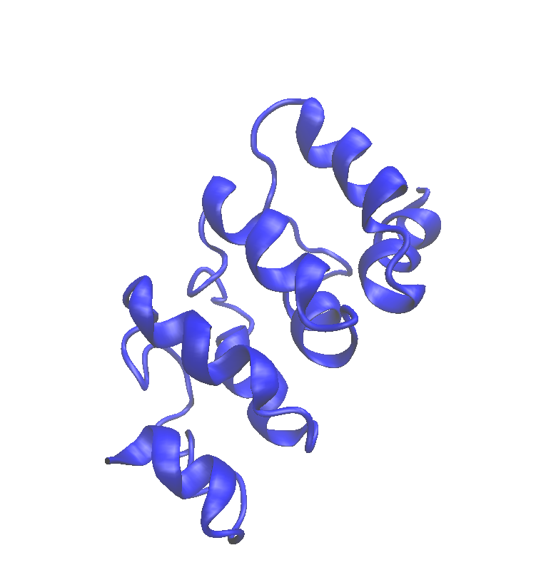
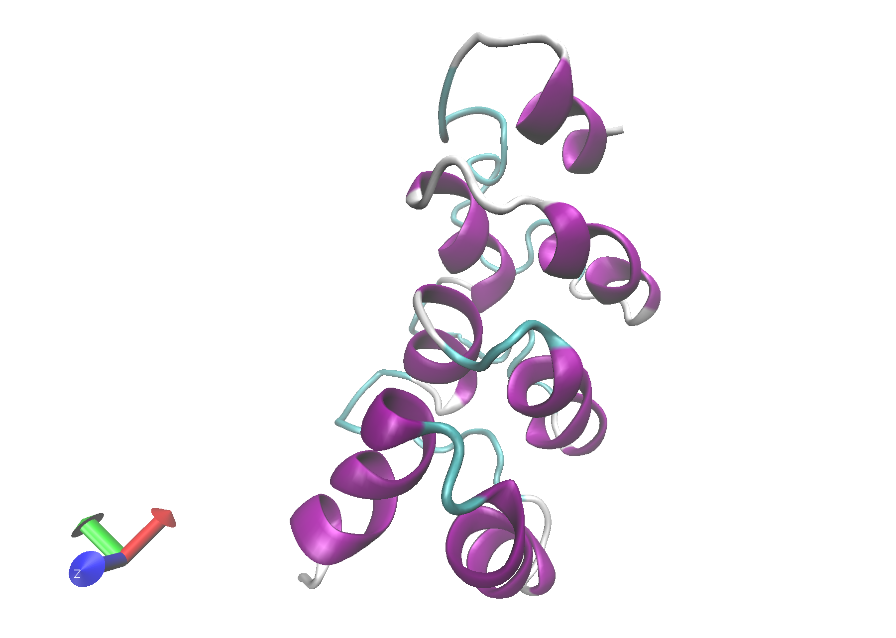
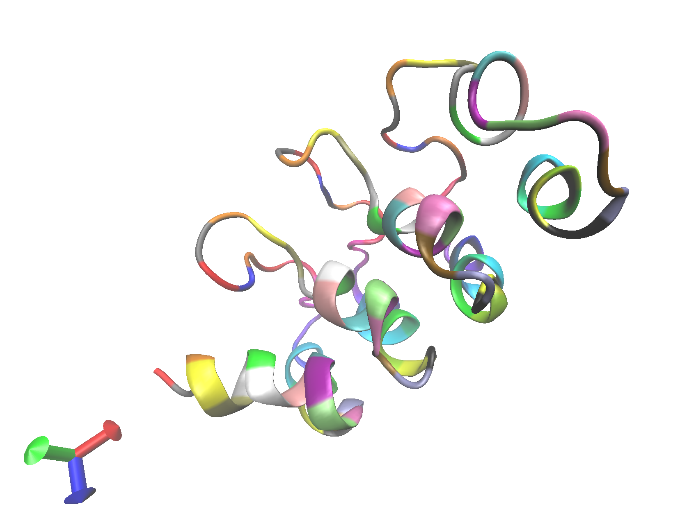
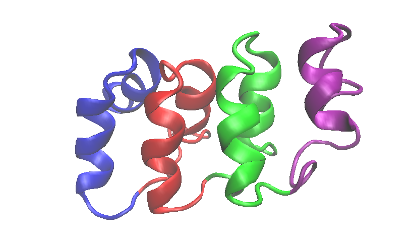
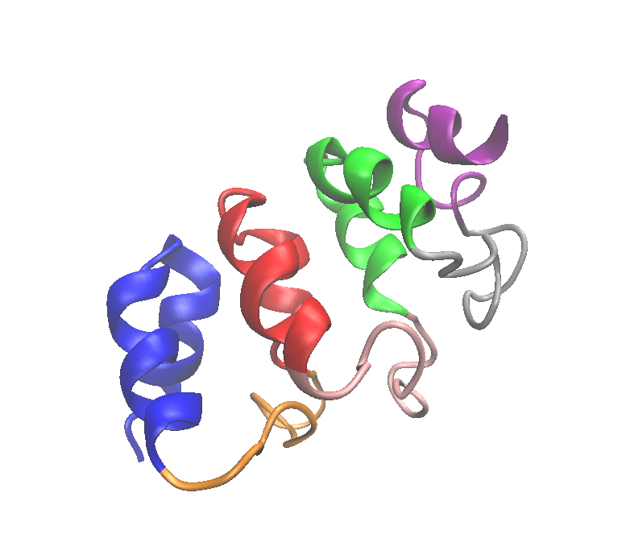
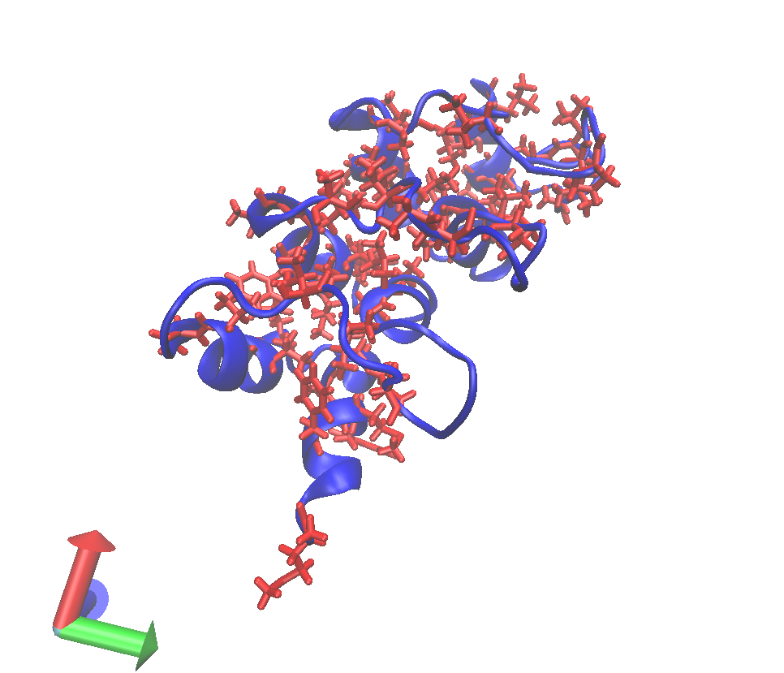
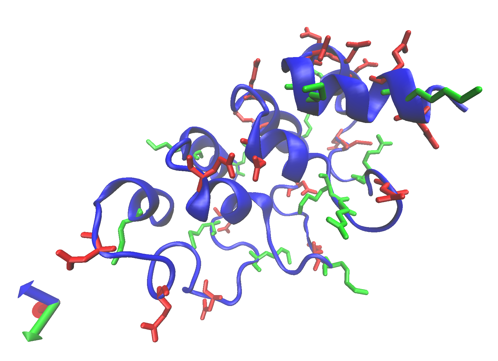

## Significato biologico

**Myotrophin** è una proteina che contiene *ankyrin-like*, associata a diversi processi cellulari. In particolare, è stata studiata per il suo coinvolgimento nell'ipertrofia cardiaca.

**IPOTESI:** esistono regioni di Myotrophin importanti per il riconoscimento dei partner proteici. Le mutazioni in queste regioni potrebbero compromettere la funzione, anche qualora migliorassero alcuni indicatori di stabilità. Questa ipotesi è supportata dall'esistenza di strutture sperimentali di complessi proteici, ma dobbiamo ancora identificare precisamente le regioni coinvolte.

## Analisi della sequenza

**DOMANDA:** da quante catene è costituita la proteina? Quale è l'assemblaggio biologico?

Nel record `REMARK 350` del file PDB troviamo l'informazione che l'assemblaggio biologico è monomerico, per cui ci aspettiamo una singola catena proteica. Ciò significa che il fold è mantenuto dalle interazioni all'interno della stessa catena.

Ciò si può vedere su VMD selezionando:
- `protein`;
- `chain`;
- `NewCartoon`.

Ciò significa che la proteina è rappresentata com euna singola catena polipeptidica e il suo assemblaggio biologico depositato è monomerico.

## Struttura sperimentale

Ci sono due diverse situazioni che possono causare problemi durante la preparazione della simulazione:
- una proteina ha dei **residui mancanti** qualora una porzione della sequenza non sia rappresentata nelle coordinate. **PROBLEMA CHIMICO:**
  - il residuo potrebbe partecipare a legami ad idrogeno, contatti idrofobici o interazioni elettrostatiche che contribuiscono al mantenimento del fold;
  - se manca una regione interna, non disponiamo delle coordinate necessarie per rappresentare correttamente la continuità del backbone;
  - il residuo potrebbe appartenere a una regione importante per il riconoscimento di altre proteine;
- una proteina ha **atomi mancanti** qualora un residuo esiste nel modello ma non contiene tutti gli atomi attesi (ex. una parte della catena laterale). **ESEMPIO di PROBLEMA CHIMICO:**
  - l'azoto terminale della lisina può essere positivamente carico e partecipare a interazioni elettrostatiche;
  - la sua assenza impedirebbe di rappresentare correttamente queste interazioni nel modello;
  - durante il setup MD, il force field richiede una descrizione coerente degli atomi, dei loro legami e dei parametri energetici.

### Verifica dei residui mancanti

Eseguendo lo script `01_check_missing_residues.tcl` otteniamo l'elenco dei residui mancanti nella struttura sperimentale. Il risultato è conferma che non mancano né residui né atomi.

## Fold della proteina

Il **fold** è la conformazione tridimensionale complessiva assunta dalla catena polipeptidica. La proteina Myotrophin appartiene alla famiglia delle proteine con *ankyrin repeats*, dove un repeat canonico presenta generalmente un motivo *helix-turn-helix* associato a regioni di collegamento. Secondo la letteratura, Myotrophin contiene quattro regioni anlyrin-like, con due repeat completi centrali, affiancati da regioni terminali dette *capping repeats*.

Possiamo identificare le strutture secondarie su VMD selezionando `protein`, `NewCartoon` e `Coloring Method: Structure`, ottenendo il risultato visibile nella seguente figura:

Modificando il campo di colorazione in `ResID` è possibile seguire la sequenza dei residui lungo la catena polipeptidica:

Si possono isolare i moduly ankyrin-like selezionando i residui corrispondenti e visualizzandoli con colori diversi nella figura:

dove in particolare abbiamo che:
- i residui 1-27 sono rappresentati in blu;
- i residui 28-60 sono rappresentati in rosso;
- i residui 61-93 sono rappresentati in verde;
- i residui 94-118 sono rappresentati in viola.
Questa divisione è basata su quanto riportato in letteratura da Yang et al. (1998).

Più nel dettaglio, si possono individuare le quattro unità helix-turn-helix viste da Takeda et al. (2021) e rappresentate nella figura seguente:

La struttura risulta quindi essere prevelentemente α-elicoidale, con regioni di loop che collegano le eliche. Le interazioni tra le eliche e i loop contribuiscono alla stabilità del fold complessivo della proteina.

## Regioni interne alla proteina e esposte al solvente

La stabilità delle proteine solubili dipende dall'organizzazione dei residui idrofobici e idrofilici:
- i residui apolari tendono a evitare un'esposizione sfavorevole all'acqua, contribuendo a formare un core idrofobico interno;
- i residui polari e carichi tendono a essere esposti al solvente oppure con altri gruppi della proteina;
- l'esposizione di superfici idrofobiche può influenzare la solubilità e l'aggregazione.

Selezionando `protein and resname ALA VAL LEU ILE MET PHE TRP PRO` con `Licorice`, lasciando inoltre evidenziata la proteina con `NewCartoon`, otteniamo la seguente rappresentazione:

La selezione evidenzia un gruppo di residui apolari (in licorice) che si trovano all'interno della proteina, contribuendo a formare il core idrofobico.

In particolar modo, creando una rappresentazione con Quicksurf, si possono osservare quali residui sembrano interni e quali sono vicini alla superficie:
- un residuo idrofobico nascosto tra più eliche può contribuire al packing del core;
- un residuo idrofobico esposto potrebbe invece partecipare a interazioni con altre proteine oppure costituire una regione di superficie con caratteristiche particolari.

### Analisi SASA per residuo

La Solvent Accessible Surface Area misura quanto una parte della proteina è accessibile al solvente, usando una sonda che rappresenta approssimativamente una molecola d'acqua. In particolare, abbiamo:
- residui con SASA bassa sono generalmente sepolti all'interno della struttura;
- residui con SASA alta sono generalmente esposti al solvente.

Tramite lo script `01_sasa_per_residue.tcl` possiamo calcolare la SASA per ogni residuo della proteina. Il risultato è rappresentato nel csv `01_sasa_per_residue.csv`, che contiene le seguenti colonne:
- `resid`: numero del residuo;
- `resname`: nome del residuo;
- `sasa`: valore della SASA calcolata in Ų.
In caso, per confrontare i valori, si possono normalizzare i valori di SASA usando la scala di Tien et al. (2013).

## Interazioni polari ed elettrostatiche

La conformazione di una proteina può essere favorita da diverse iterazioni non covalenti, di cui due categorie sono:
- **legami a idrogeno:** interazioni tra un donatore e un accettore, rilevanti per la struttura secondaria e per l'organizzazione delle catene laterali. Contribuiscono a determinare e mantenere geometrie locali specifiche, ma il loro effetto netto sulla stabilità dipende anche dalle interazioni con il solvente;
- **salt bridges:** interazioni fra gruppi con cariche opposte. Questa attrazione può contribuire alla stabilizzazione della struttura, mantenendo vicine due eliche o due ankyrin repeats.
Il contributo effettivo di queste interazioni alla stabilità dipende dall'ambiente locale, dalla presenza di solvente e dal bilancio energetico complessivo. 

**IPOTESI:** alcuni residui polari e carichi potrebbero formare una rete di interazioni che contribuisce alla geometria dei repeat. La sola presenza di residui carichi vicini, però, non dimostra automaticamente l'esistenza di una salt bridge favorevole.

In una prima analisi, possiamo evidenziare:
- i residui acidi (tramite `resname ASP GLU and noh`) in licorice colorati in rosso;
- i residui basici (tramite `resname LYS ARG and noh`) in licorice colorati in verde.
La rappresentazione è nella seguente figura:

Dai csv 2myo_saltbridges_static.csv e 2myo_hbonds_static.csv possiamo ottenere informazioni sulle interazioni polari ed elettrostatiche presenti nella struttura sperimentale. In particolare, possiamo osservare:
- 21 legami a idrogeno potenziali, dopo il filtraggio dei 41 contatti iniziali. Sono prevalentemente interazioni tra atomi del backbone, spesso tra residui separati da quattro posizioni, coerentemente con la struttura α-elicoidale della proteina;
- due possibili interazioni elettrostatiche, ASP27–ARG30 (3,91 Å) e ASP65–LYS97 (3,96 Å). La seconda è particolarmente interessante perché collega regioni distanti nella sequenza.

I legami a idrogeno sembrano contribuire principalmente al mantenimento delle strutture secondarie, mentre i contatti elettrostatici potrebbero favorire l'organizzazione tridimensionale della proteina. Tuttavia, la loro effettiva stabilità e persistenza dovranno essere verificate attraverso le simulazioni MD.

