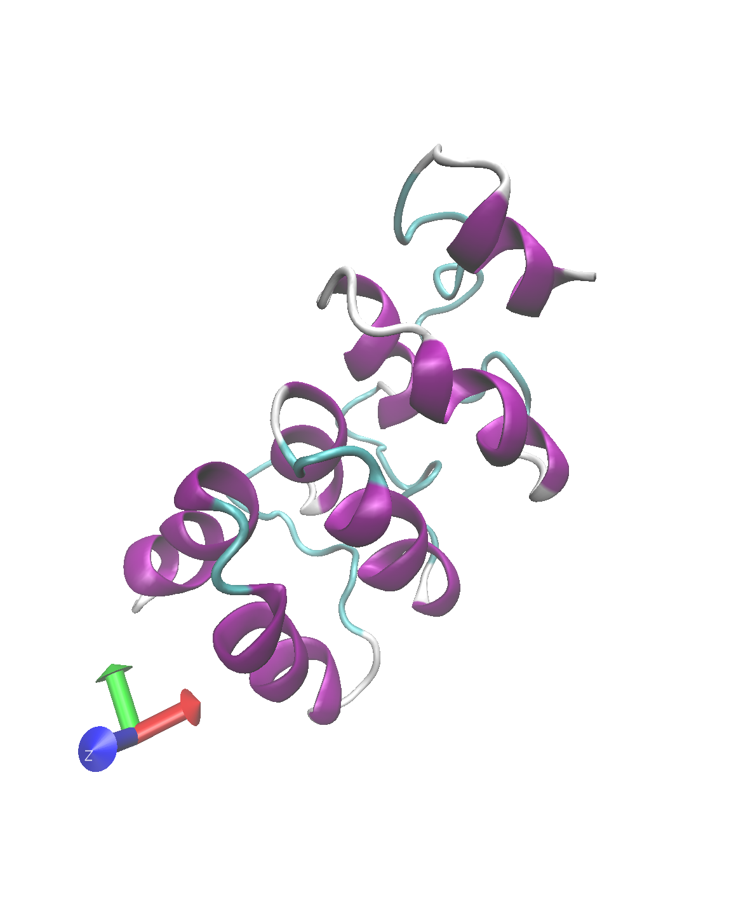
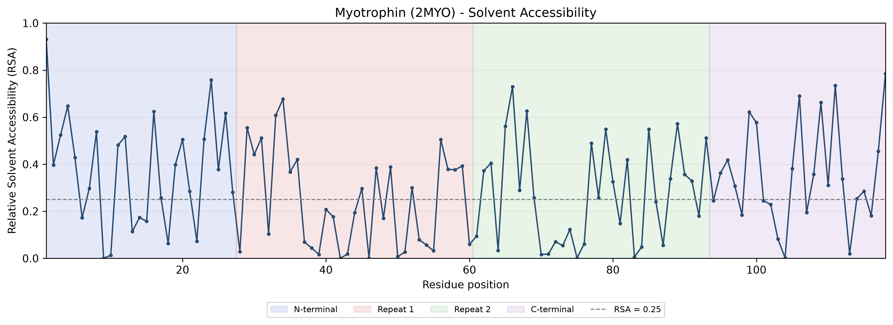
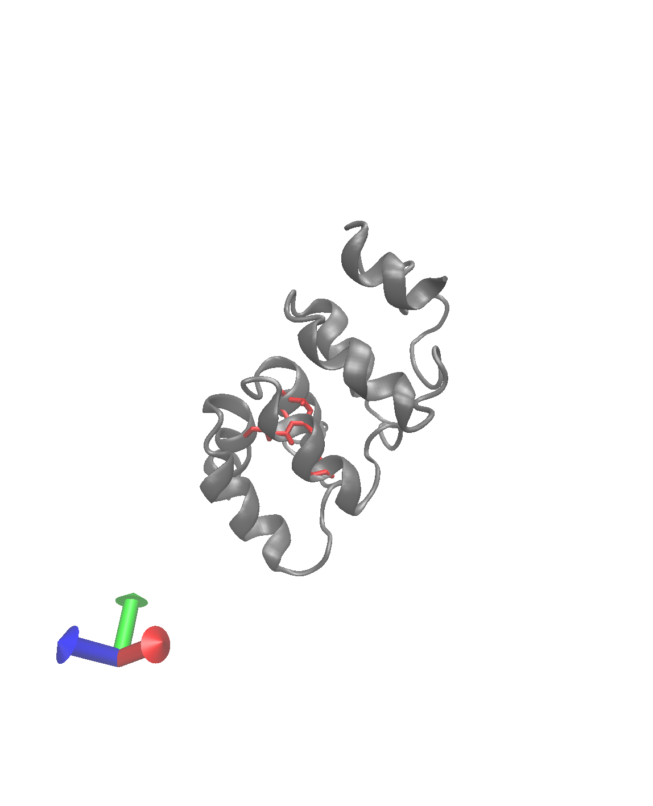

# Biological background and function of the protein

## Protein overview and biological function

**Myotrophin (MTPN)** is a small intracellular protein of approximately 13 kDa belonging to the ankyrin-repeat protein family. The protein investigated in this project is the 118-amino-acid Myotrophin from Rattus norvegicus, whose three-dimensional structure is available in the Protein Data Bank (PDB ID: 2MYO) [1].

Ankyrin repeats are structural motifs commonly involved in protein–protein interactions. Their characteristic arrangement of α-helices and connecting loops provides a framework for molecular recognition, allowing ankyrin-repeat proteins to interact with different cellular partners. Consequently, the structural integrity of Myotrophin is important for maintaining its biological interactions [1].

Myotrophin was initially identified in hypertrophic rat hearts and human cardiac tissue, and early studies suggested its involvement in the development of **cardiac hypertrophy**, a condition characterized by an increase in cardiomyocyte size. Subsequent studies investigated its involvement in intracellular signaling pathways, particularly NF-κB signaling, while its originally proposed role as an extracellular hypertrophic factor has been questioned [3, 4].

Another experimentally characterized function of Myotrophin concerns the **regulation of the actin cytoskeleton**. Myotrophin interacts directly with actin-capping protein (CP), a heterodimeric protein that binds to the barbed ends of actin filaments and prevents further addition or removal of actin subunits. By binding to CP, Myotrophin inhibits its capping activity, thereby contributing to the regulation of actin filament dynamics [2].

## Relevance to Protein Engineering

The biological functions of Myotrophin are closely related to its ability to maintain a well-defined three-dimensional structure and interact with other proteins. Therefore, improving its stability requires considering not only the preservation of its overall fold but also the structural features involved in molecular recognition.

In particular, amino acid substitutions may modify local packing, hydrogen-bond networks, electrostatic interactions, or solvent exposure. While some of these changes could improve protein stability, others might alter functionally relevant regions or interfere with interactions between Myotrophin and its binding partners.

The aim of this project is to **identify amino acid substitutions that may improve the thermal stability of Myotrophin while minimizing potential alterations to its structural and functional characteristics.**

To achieve this, the experimental structure of the wild-type protein will first be characterized in terms of its overall architecture, solvent accessibility, and intramolecular interactions. This analysis will provide the structural basis for selecting candidate mutations, which will subsequently be evaluated using computational stability prediction tools and molecular dynamics simulations.

Importantly, the preservation of structural properties in computational models cannot, by itself, demonstrate that biological function is retained. Experimental validation would ultimately be required to confirm both improved thermal stability and functional activity.

# Experimental structure and sequence analysis

Is the experimental structure of Myotrophin (PDB: 2MYO) complete, correctly represented, and suitable as a starting point for computational modelling?

## Experimental structure metadata

The three-dimensional structure of Myotrophin was obtained from the Protein Data Bank (PDB ID: 2MYO). The structure, determined by Yang et al. (1998) using solution Nuclear Magnetic Resonance (NMR) spectroscopy, corresponds to a minimized average structural model of the protein from *Rattus norvegicus* [1].

NMR spectroscopy allows the investigation of molecular structures in solution by measuring the response of atomic nuclei to radiofrequency radiation in a strong magnetic field. The resonance frequencies depend on the local chemical environment of each nucleus, providing information that can be used to identify specific atoms within a protein.

Through multidimensional NMR experiments, researchers can derive **structural restraints**, such as approximate distances between atoms and constraints on backbone torsion angles. These experimental measurements are then combined with computational modelling to generate three-dimensional conformations that satisfy the observed restraints while maintaining physically reasonable molecular geometry.

In the case of Myotrophin, Yang et al. used 2,786 experimental NMR restraints and the X-PLOR software to calculate the protein structure through a simulated annealing procedure. This computational approach explores different molecular conformations and progressively minimizes violations of the experimental constraints [1].

According to the experimental information reported in the PDB file, the structure was determined at 297 K and pH 6.2, using a sample containing 50 mM phosphate buffer. A total of 90 conformers were calculated, but only one model was deposited in the 2MYO entry. An additional PDB entry, 1MYO, contains 44 conformations from the same structural study.

Consequently, **2MYO represents a single structural model rather than the complete NMR conformational ensemble**. While it provides a useful starting point for structural characterization and molecular modelling, it does not directly describe the time-dependent conformational fluctuations of the protein.

Furthermore, since the structure was obtained using NMR rather than X-ray crystallography, a crystallographic resolution value is not applicable.

## Molecular composition and biological assembly

Before performing detailed structural analyses, the molecular composition of the experimental model was examined to identify its constituent chains and determine the biological assembly.

The PDB file contains a single protein chain, identified as chain A, consisting of 118 amino acid residues. The biological assembly is reported as monomeric in the PDB annotation (REMARK 350), indicating that a single protein chain constitutes the biological unit represented by this entry.

The molecular composition was additionally verified using Visual Molecular Dynamics (VMD), by selecting the protein atoms and inspecting their chain identifiers and residue numbers.

The structure contains 1,815 atoms, including 902 heavy atoms and 913 hydrogen atoms. Heavy atoms are all non-hydrogen atoms, primarily carbon, nitrogen, oxygen and sulfur, which form the molecular backbone and amino acid side-chain framework. Hydrogen atoms contribute to the chemical structure and play an important role in hydrogen bonding and electrostatic interactions. This distinction is relevant for subsequent analyses, since some structural measurements consider only heavy atoms, whereas molecular dynamics simulations require an appropriate representation of both heavy atoms and hydrogens.

No additional protein chains, ligands, cofactors, or solvent molecules are represented in the deposited coordinates.

These observations establish that 2MYO provides an isolated monomeric model of Myotrophin, suitable for investigating its intramolecular structural organization without additional molecular partners. However, the absence of interacting molecules in the PDB model does not exclude their relevance under biological conditions.

## Sequence and residue numbering

A sequence consistency check was performed to verify that the amino acid sequence represented in the experimental coordinates corresponds to the sequence declared in the PDB file.

The `SEQRES` records describe the complete amino acid sequence associated with the deposited chain, whereas the `ATOM` records contain the experimentally derived atomic coordinates. Comparing these records makes it possible to identify residues that may be present in the sequence but absent from the structural model.

The analysis confirmed that chain A contains 118 amino acid residues, continuously numbered from `MET1` to `GLN118`, with no sequence identity mismatches between the `SEQRES` and `ATOM` records.

The PDB file also includes a reference to UniProt accession P62775, corresponding to rat Myotrophin. According to the deposited `DBREF` record, residues 2–118 of the PDB structure are mapped to positions 1–117 of the referenced UniProt sequence. The initial methionine (MET1) is not included in this mapping.

This distinction is relevant for mutation design, since the same residue may have different position numbers depending on the sequence reference used.

To avoid ambiguity, all residue positions in this project will refer to the numbering of the original PDB structure 2MYO, chain A, unless explicitly stated otherwise.

## Structural completeness analysis

Structural completeness was evaluated before performing more detailed molecular analyses. Missing residues or atoms can compromise the representation of local interactions and require additional modelling before molecular dynamics simulations can be performed.

A TCL script was executed to compare the amino acid sequence declared in the `SEQRES` records with the atomic coordinates reported in the `ATOM` records. For each residue, the script checked the presence of the expected backbone and side-chain heavy atoms, using the standard atomic composition of the corresponding amino acid.

Additional checks were performed to identify unexpected or duplicated atoms, non-standard residues, insertion codes, alternative atom locations, and unexpected protein chains.

The analysis produced the following results:
| Structural property | Result |
| :--- | ---: |
| Expected residues (SEQRES, chain A) | 118 |
| Residues with heavy-atom coordinates | 118 |
| Cα atoms | 118 |
| Heavy atoms | 902 |
| Hydrogen/deuterium atoms | 913 |
| Missing residues | None |
| Residue identity mismatches | None |
| Missing heavy atoms | None |
| Unexpected heavy atoms | None |
| Duplicate heavy atoms | None |
| Residues outside the expected range | None |
| Non-standard residues | None |
| Insertion codes | None |
| Alternate atom locations | None |
| Other ATOM chains | None |

The results confirm that the deposited structure is complete with respect to its declared amino acid sequence and expected heavy-atom composition.

In particular, no missing residues or incomplete side chains were identified, indicating that additional structural reconstruction is not required to address these specific issues.

However, structural completeness does not imply that the molecular geometry is fully optimized. The present analysis does not assess bond lengths, bond angles, protonation states, or compatibility with a molecular mechanics force field. These properties must be considered separately when preparing the system for molecular dynamics simulations.

## Structural geometry and model limitations

In addition to sequence and atomic completeness, the geometric quality of the experimental structure was examined through the validation information provided in the PDB file, particularly the REMARK 500 records.

These records report structural features that deviate from selected geometric or stereochemical criteria and may require additional investigation.

### Close contacts

The PDB file identifies four pairs of atoms exhibiting unusually short interatomic distances.

| Atom 1 | Atom 2 | Distance (Å) |
| :--- | :--- | ---: |
| GLY13 O | LEU15 H | 1.50 |
| LYS4 O | TRP8 H | 1.51 |
| LEU87 O | LYS90 H | 1.58 |
| HIS80 O | SER82 N | 2.14 |

The first three contacts involve backbone oxygen and hydrogen atoms, which may participate in hydrogen-bond interactions. Therefore, a short distance does not necessarily indicate an unfavorable steric clash.

In contrast, the close contact between the backbone oxygen of HIS80 and the nitrogen of SER82 involves two heavy atoms and deserves closer geometric inspection.

A definitive interpretation of these contacts requires considering the chemical identities of the atoms and their relative orientations, rather than interatomic distances alone.

### Backbone torsion angles

The PDB file also reports 35 residues with backbone torsion angles outside the expected Ramachandran regions, according to the validation criteria referenced in the original record.

Backbone conformation is primarily described by two dihedral angles, phi (φ) and psi (ψ), which characterize rotations around bonds involving the alpha carbon. Their combinations determine the local geometry of the polypeptide chain and are constrained by steric and energetic considerations.

A Ramachandran plot represents these combinations and identifies regions commonly associated with favorable backbone conformations, including those characteristic of α-helices and β-strands.

Among the residues reported in REMARK 500, HIS68, ASP93, and THR103 are particularly noteworthy because they correspond to positions that may be considered for subsequent mutation design.

However, an unusual backbone conformation is not, by itself, evidence of local instability. Such conformations may arise from specific structural requirements, local interactions, or limitations of the experimental model.

Therefore, the reported geometric deviations should be regarded as structural features requiring further investigation rather than direct indicators of potentially stabilizing mutation sites.

### Implications for molecular modelling

Although the 2MYO structure is complete in terms of residues and heavy atoms, the geometric observations reported in REMARK 500 emphasize the need for careful structural preparation before molecular dynamics simulations.

In particular, appropriate protonation states, molecular geometry, and local steric interactions should be checked during system preparation and energy minimization.

Furthermore, because the deposited structure represents a single NMR-derived model, static structural observations cannot directly establish protein flexibility or thermal stability.

These properties will be investigated in subsequent stages through molecular dynamics simulations and the analysis of structural observables.

Overall, 2MYO provides a complete experimental starting structure for the project, while its geometric characteristics and experimental limitations must be considered when preparing and interpreting subsequent computational analyses.

# Overall protein fold and secondary structure

The overall three-dimensional organization of Myotrophin was examined using Visual Molecular Dynamics (VMD), with the experimental structure (PDB ID: 2MYO, chain A) displayed using the NewCartoon representation and colored according to secondary structure.

Secondary structure describes the local organization of the polypeptide backbone into regular structural elements, such as α-helices and β-strands, as well as turns and irregular regions. Its characterization provides a basis for understanding the overall protein fold and identifying structural elements that may contribute to its stability.

Secondary structure assignments were recalculated from the experimental coordinates using STRIDE, which classifies residues according to their backbone geometry and hydrogen-bonding patterns.

The analysis identified 55 residues assigned to α-helices (46.6%), 41 to turns (34.7%), and 22 to coil regions (18.6%), with no residues assigned to β-sheet structures.

Seven continuous α-helical segments were identified, as summarized in the following table.

| Helix | Residue range | Length |
| :--- | :--- | ---: |
| H1 | ASP3–ASN12 | 10 |
| H2 | LEU15–ALA23 | 9 |
| H3 | LEU39–ASP44 | 6 |
| H4 | GLU49–LYS57 | 9 |
| H5 | PRO71–TYR77 | 7 |
| H6 | SER82–SER89 | 8 |
| H7 | ALA112–LEU117 | 6 |

Minor differences were observed between the STRIDE assignments and the original PDB secondary structure annotations, particularly at the boundaries of some helical segments. These differences may arise from the distinct criteria used for secondary structure classification.

*Figure 1. Overall three-dimensional structure of Myotrophin (PDB ID: 2MYO, chain A), visualized in VMD using the NewCartoon representation. α-Helices are shown in purple, turns in cyan, and coil regions in white.*

As shown in Figure 1, Myotrophin exhibits a predominantly α-helical fold, with several helices arranged along an elongated and repetitive architecture. These regular structural elements are connected by turns and coil regions, which contribute to the overall organization of the polypeptide chain.

The spatial arrangement of the α-helices is consistent with the ankyrin-repeat architecture described by Yang et al. (1998) [1]. In particular, the organization of helical segments suggests the presence of repeated structural motifs, examined in more detail below.

## Ankyrin-repeat architecture

Myotrophin belongs to the ankyrin-repeat protein family, characterized by repeated structural units of approximately 33 amino acids. A typical ankyrin repeat consists of a protruding loop followed by two α-helices connected by a short turn, forming a characteristic helix–turn–helix motif.

According to Yang et al. (1998), Myotrophin contains two complete central ankyrin repeats, corresponding to residues 28–60 and 61–93, flanked by non-canonical N- and C-terminal regions [1].

To investigate this organization, the protein was divided into four structural regions and visualized in VMD using different colors.

| Region | Residue range | Length | Helical segments |
| :--- | :--- | ---: | :--- |
| N-terminal region | 1–27 | 27 | H1, H2 |
| Ankyrin repeat 1 | 28–60 | 33 | H3, H4 |
| Ankyrin repeat 2 | 61–93 | 33 | H5, H6 |
| C-terminal region | 94–118 | 25 | H7 |

*Figure 2. Structural organization of Myotrophin into four ankyrin-like regions. The N-terminal region (residues 1–27) is shown in blue, the first complete repeat (28–60) in red, the second complete repeat (61–93) in green, and the C-terminal region (94–118) in purple.*

As shown in Figure 2, the two central repeats exhibit a similar organization, each containing two α-helical segments. The terminal regions present a different arrangement, reflecting their non-canonical repeat architecture.

The helix–turn–helix motifs were further examined by highlighting the three main pairs of helices identified through STRIDE.

*Figure 3. Three helix–turn–helix motifs identified in Myotrophin. The N-terminal motif (residues 3–23) is shown in blue, the first central repeat motif (39–57) in red, and the second central repeat motif (71–89) in green. The remaining regions are shown in gray.*

Figure 3 highlights the repetitive arrangement of the helical pairs, which form the main structural framework of Myotrophin. This organization is consistent with the structural description of Yang et al. (1998), who reported that the V-shaped helix–turn–helix motifs stack sequentially and are stabilized by compact hydrophobic cores [1].

The C-terminal region differs from the three preceding motifs, since only one continuous α-helical segment was identified by STRIDE.

In addition to the helical framework, two hairpin-like protruding loops associated with the central ankyrin repeats were examined: residues 32–36 in the first repeat and 65–69 in the second.

*Figure 4. Hairpin-like regions associated with the two complete ankyrin repeats of Myotrophin. Residues 32–36 are highlighted in red and residues 65–69 in blue, while the remaining protein structure is shown in gray.*

As shown in Figure 4, both regions form protruding segments extending away from the central helical framework. Unlike the main α-helical segments, these loops do not adopt regular helical conformations.

Their organization agrees with the structural observations of Yang et al. (1998), who described protruding tips as characteristic elements of the ankyrin-repeat architecture [1].

Previous NMR investigations also reported differences in the conformational behavior of the two hairpin-like regions [5]. However, the VMD representations correspond to a single structural model and therefore cannot directly establish differences in flexibility or conformational dynamics.

## Structural implications for protein stability

The structural analysis of Myotrophin revealed a predominantly α-helical architecture, with consecutive ankyrin-like regions forming a repetitive fold. As described by Yang et al. (1998), the arrangement of neighboring helices is supported by hydrophobic interactions that contribute to maintaining the overall protein structure [1].

These observations suggest that the stability of Myotrophin may depend on both local interactions within individual repeats and contacts between adjacent structural regions. However, the static NMR model does not allow us to determine which residues contribute most strongly to stability or how the protein responds to thermal stress.

Therefore, **the next step is to investigate solvent accessibility and intramolecular interactions**, identifying buried and exposed residues and characterizing the contacts that support the protein fold. These analyses will provide a structural basis for selecting potential stabilizing mutations and subsequently evaluating their effects through molecular dynamics simulations.

# Solvent accessibility and hydrophobic packing

To investigate the solvent exposure of Myotrophin, the Solvent Accessible Surface Area (SASA) was calculated for all 118 residues using VMD, considering only heavy atoms and a probe radius of 1.4 Å. The resulting values were normalized using reference maximum accessible surface areas from Tien et al. (2013) to obtain the Relative Solvent Accessibility (RSA).[6]

*Figure 5. Relative solvent accessibility along the Myotrophin sequence. The four ankyrin-like regions are highlighted with different background colors, and the dashed line indicates the RSA = 0.25 threshold used to distinguish exposed residues.*

The analysis identified **19 buried residues (RSA < 0.05), 31 partially exposed residues, and 68 exposed residues (RSA ≥ 0.25)**. As shown in Figure 5, solvent accessibility varies along the protein sequence, with the two central ankyrin repeats exhibiting lower average RSA values than the terminal regions.

To further examine hydrophobic packing, selected poorly exposed nonpolar residues were visualized in VMD.

*Figure 6. Structural localization of selected hydrophobic residues (ALA42, ILE50, LEU51, and LEU54), highlighted in red, within the first ankyrin repeat. The protein backbone is represented in gray.*

These residues exhibit low solvent accessibility and are located near the α-helical framework of the first ankyrin repeat. Their arrangement is consistent with the hydrophobic packing described by Yang et al. (1998), which contributes to the structural organization of Myotrophin.

Overall, the analysis provides a quantitative description of residue exposure and supports the presence of buried hydrophobic regions within the ankyrin-repeat architecture. However, these observations are based on a single static structure and do not directly establish the energetic contribution of individual residues or their influence on thermal stability.

# Intramolecular interactions

To further characterize the structural organization of Myotrophin, intramolecular hydrogen bonds, salt bridges, and disulfide bonds were investigated using VMD on the experimental structure (PDB ID: 2MYO, chain A).

**Hydrogen bonds** were identified using geometric criteria, considering N–H···O interactions with a donor–acceptor distance of up to 3.5 Å and a donor–hydrogen–acceptor angle of at least 150°. The analysis identified **21 candidate hydrogen bonds**, predominantly involving backbone atoms. Most interactions occur between residues separated by three or four positions along the sequence, consistent with the hydrogen-bonding patterns associated with α-helical structures.

**Salt bridges** were investigated by identifying close contacts between oppositely charged amino acid side chains, using a distance threshold of 4 Å. Two candidate interactions were identified:

| Residue pair | Minimum distance (Å) |
| :--- | ---: |
| ASP27–ARG30 | 3.913 |
| ASP65–LYS97 | 3.963 |

The ASP27–ARG30 interaction is located near the boundary between the N-terminal region and the first ankyrin repeat, while ASP65–LYS97 involves residues belonging to different structural regions. These contacts may contribute to local electrostatic interactions within the protein.

Finally, potential **disulfide bonds** were evaluated by measuring the distances between the sulfur atoms of CYS2, CYS45, and CYS83. The minimum SG–SG distance was 9.434 Å (CYS45–CYS83), substantially greater than the approximately 2 Å expected for a disulfide bond. Therefore, no disulfide bonds were identified in the analyzed structure.

Overall, these results provide a description of the hydrogen-bonding and electrostatic interactions present in Myotrophin. However, since the analysis is based on a single NMR structural model, the identified contacts represent geometrically plausible interactions rather than evidence of their persistence or contribution to thermal stability. Their behavior under thermal stress can be investigated through subsequent molecular dynamics simulations.

# References

[1] Yang, Y., Nanduri, S., Sen, S., & Qin, J. (1998). The structural basis of ankyrin-like repeat function as revealed by the solution structure of myotrophin. Structure, 6(5), 619–626. https://doi.org/10.1016/S0969-2126(98)00063-X

[2] Takeda, S., et al. (2010). Two distinct mechanisms for actin capping protein regulation—steric and allosteric inhibition. PLOS Biology, 8(7), e1000416. https://doi.org/10.1371/journal.pbio.1000416

[3] Gupta, S., Purcell, N. H., Lin, A., & Sen, S. (2002). Activation of nuclear factor-κB is necessary for myotrophin-induced cardiac hypertrophy. Journal of Cell Biology, 159(6), 1019–1028. https://doi.org/10.1083/jcb.200207149

[4] Knuefermann, P., Shi, S. P., Chen, P., Sakata, Y., Baumgarten, G., & Sivasubramanian, N. (2006). Myotrophin/V-1 does not act as an extracellular signal to induce myocyte hypertrophy. Texas Heart Institute Journal, 33(3), 281–289. https://pubmed.ncbi.nlm.nih.gov/17041682/

[5] Yang, Y., Rao, N. S., Walker, E., Sen, S., & Qin, J. (1997). Nuclear magnetic resonance assignment and secondary structure of an ankyrin-like repeat-bearing protein: myotrophin. Protein Science, 6(6), 1347–1351. https://doi.org/10.1002/pro.5560060625

[6] Tien, M. Z., Meyer, A. G., Sydykova, D. K., Spielman, S. J., & Wilke, C. O. (2013). Maximum allowed solvent accessibilities of residues in proteins. PLOS ONE, 8(11), e80635. https://doi.org/10.1371/journal.pone.0080635