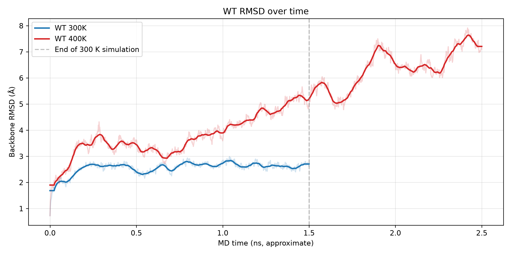
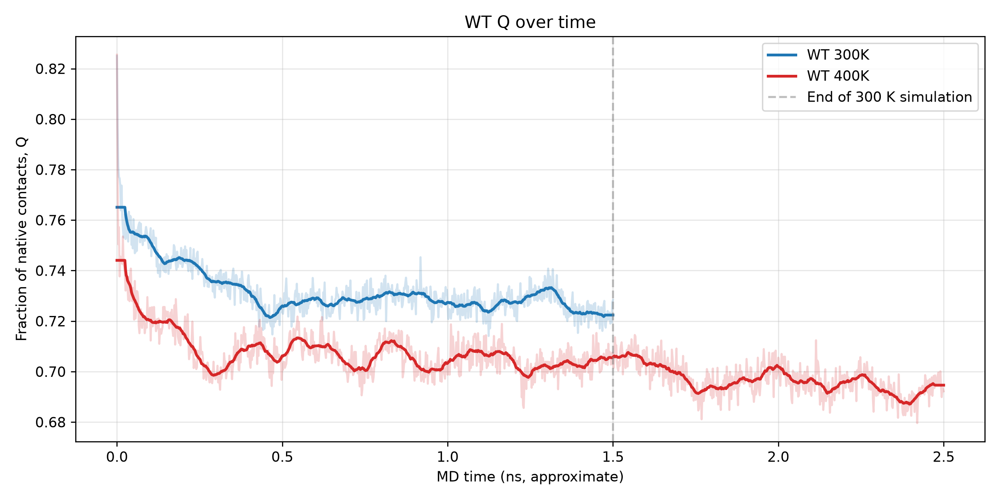
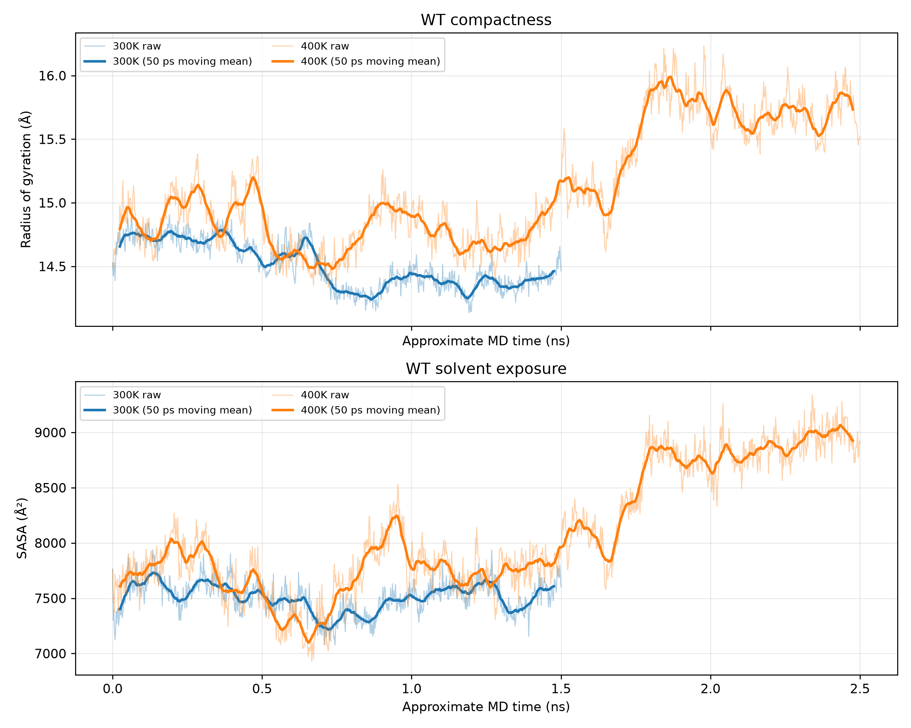
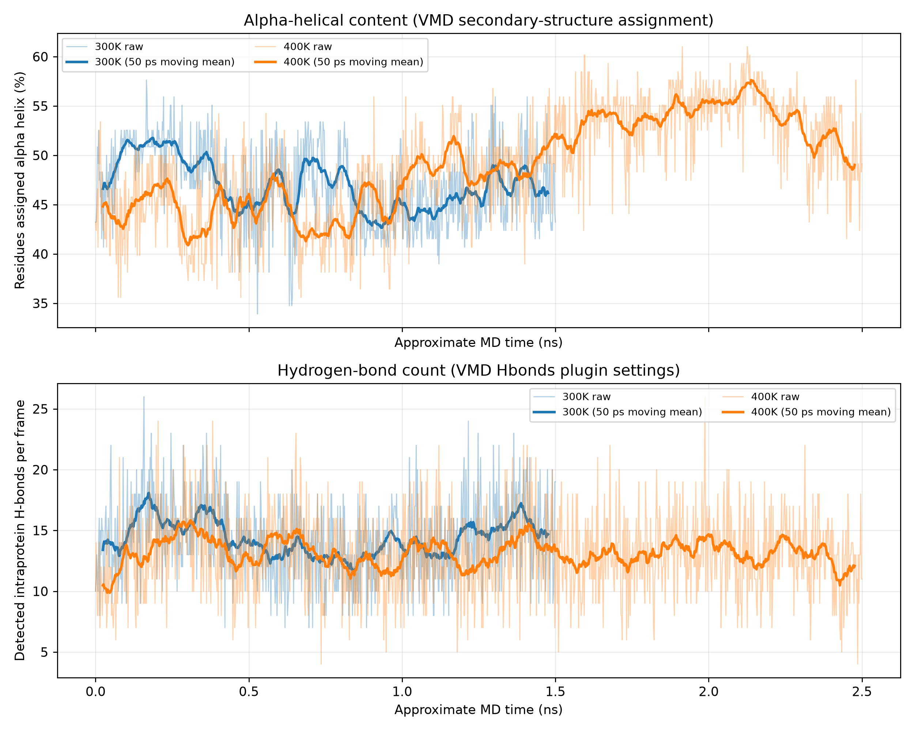
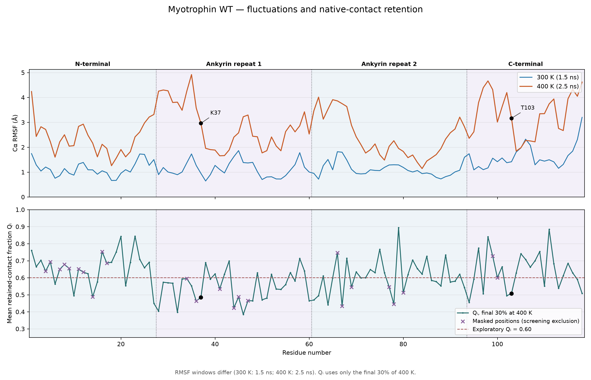

# Wild-type system preparation

Before performing molecular dynamics (MD) simulations, the experimental structure of wild-type Myotrophin (PDB ID: 2MYO) was prepared to obtain a molecular system compatible with the CHARMM36m force field and the NAMD simulation engine.

As established in the initial structural characterization, the deposited NMR structure consists of a complete protein chain containing 118 amino acid residues, with no missing heavy atoms. However, although the experimental PDB file provides atomic coordinates, it does not directly provide all the molecular topology, force-field parameters, and solvent environment required for MD simulations.

The preparation procedure therefore involved assigning the protonation states of selected residues, reconstructing the protein topology and hydrogen atoms, introducing an explicit solvent environment, adding ions, and defining periodic boundary conditions.

The procedure was performed using Visual Molecular Dynamics (VMD), together with the psfgen, solvate, and autoionize plugins.

## Preparation of the experimental structure

The starting structure was the original 2MYO.pdb file, containing 1,815 atoms, including 902 heavy atoms and 913 hydrogen atoms.

Before generating the molecular topology, the protonation states of the four histidine residues (HIS40, HIS67, HIS68, and HIS80) were explicitly assigned.

Histidine residues require particular attention during molecular system preparation because their imidazole side chains can adopt different protonation states, affecting local hydrogen-bonding patterns and electrostatic interactions.

In the CHARMM36m representation, the neutral states HSD and HSE differ in the protonation of the ND1 and NE2 nitrogen atoms, respectively.

The original NMR structure provided an initial representation consistent with HSD for all four histidines. This assignment was retained for HIS40, HIS68, and HIS80, whereas HIS67 was assigned to HSE based on its local structural environment and potential hydrogen-bonding interactions.

| Residue | Original representation | Assigned state |
| :--- | :--- | :--- |
| HIS40 | ND1-protonated | HSD |
| HIS67 | ND1-protonated | HSE |
| HIS68 | ND1-protonated | HSD |
| HIS80 | ND1-protonated | HSD |

These assignments were adopted as modelling assumptions rather than independently validated protonation states, since no explicit pKa prediction or energetic comparison of alternative states was performed.

After assigning the histidine states, the original hydrogen atoms were removed using the VMD selection protein and noh, preserving the 902 heavy atoms and their initial coordinates.

The resulting structure was saved as 2myo_clean_noh.pdb.

This step allowed the hydrogen atoms to be reconstructed consistently with the chosen force field and protonation states, avoiding potential differences between the hydrogen nomenclature of the experimental model and that required by CHARMM.

## Reconstruction of the protein topology

The protein topology was generated using psfgen and the CHARMM36m protein topology definitions (top_all36_prot.rtf).

CHARMM36m is an all-atom molecular mechanics force field that provides a parametrized description of protein interactions. Its topology definitions specify the expected atoms, their connectivity, and their chemical properties, while the associated parameter files provide the energetic terms used during MD simulations.

Starting from the heavy-atom coordinates, psfgen reconstructed the missing hydrogen atoms according to the selected residue protonation states and generated two files:
- 2myo_wt.pdb, containing the coordinates of the reconstructed protein.
- 2myo_wt.psf, containing the molecular topology, including atom types, masses, partial charges, and bonded interactions.

The reconstructed protein contained 1,815 atoms, including 902 heavy atoms and 913 hydrogen atoms.

Although the total number of atoms coincided with that of the original NMR structure, the hydrogen atoms were newly generated according to the CHARMM representation rather than simply preserved from the experimental PDB.

The topology construction also involved atom-name conversions for compatibility with CHARMM, including the isoleucine CD1 atom and the terminal carboxyl oxygen atoms.

Structural verification confirmed that all 118 Cα atoms retained their original coordinates, with a maximum displacement of 0.0000 Å. A further comparison of the heavy atoms showed that the original coordinates were preserved for 900 atoms, after accounting for atom-name conversions. The two terminal oxygen atoms of GLN118 were repositioned by approximately 0.6 Å during reconstruction of the terminal group.

The resulting topology assigned a net charge of −5e to the protein.

These results indicate that topology generation preserved the overall experimental backbone geometry while introducing the chemical representation required for the subsequent MD simulations.

## Solvation with explicit water

To reproduce an aqueous environment, the reconstructed protein was solvated using the VMD solvate plugin.

An explicit solvent representation was selected, using the TIP3P water model. In this model, each water molecule is represented by three interaction sites corresponding to one oxygen atom and two hydrogen atoms.

Explicit water molecules were introduced around the protein with a nominal padding of 12 Å, intended to provide sufficient solvent between the protein and the boundaries of the simulation box.

The resulting files, 2myo_wb.pdb and 2myo_wb.psf, contained the protein and 6,576 water molecules.

Since each TIP3P water molecule contributes three atoms, the total system size increased to:
$$1815 + 3(6576) = 21543 \text{ atoms}$$

The introduction of explicit solvent provides a molecular representation of protein–water interactions, including hydrogen bonding, electrostatic interactions, and solvent-mediated effects that may influence protein structure and dynamics.

## Ionization and charge neutralization

Following solvation, the system was neutralized and supplemented with sodium and chloride ions using the VMD autoionize plugin.

The preparation requested a nominal NaCl concentration of 0.15 M, representing a physiological-like ionic environment.

Because the protein carried a net charge of −5e, additional sodium counterions were required to obtain an electrically neutral simulation system.

The ionization procedure replaced 41 water molecules with 23 sodium ions (Na⁺) and 18 chloride ions (Cl⁻).

The total charge after ionization was:
$$Q_{\mathrm{total}}=-5+23-18=0$$

The final system contained 6,535 water molecules and 41 ions. Its total number of atoms was therefore:
$$1815+3(6535)+23+18=21461$$
The resulting files were saved as 2myo_wb_ionized.pdb and 2myo_wb_ionized.psf.

The requested salt concentration represents the preparation target rather than an independently measured final ion concentration, since the number of ions is discrete and additional counterions are required for neutralization.

## Definition of periodic boundary conditions

Periodic boundary conditions (PBC) were introduced to approximate a bulk solvent environment while using a finite number of water molecules.

Under PBC, the simulation cell is periodically replicated in three dimensions, reducing artificial effects associated with the presence of finite boundaries.

The dimensions of the prepared solvent box were determined from the minimum and maximum atomic coordinates of the final system.

The resulting orthorhombic box dimensions were:
| Dimension | Length (Å) |
| :--- | ---: |
| X | 71.840 |
| Y | 58.972 |
| Z | 54.840 |

The preparation script also calculated the average atomic position of the system, obtaining a center of approximately (7.713, −8.094, 86.015) Å.

These parameters were saved in pbc_box_params.txt for subsequent use in NAMD.

The final geometric verification indicated protein-to-coordinate-boundary margins of approximately 12 Å along each direction, consistent with the padding requested during solvation.

However, these margins were derived from the atomic-coordinate extrema and do not independently establish the minimum separation between periodic images. The consistency of the cell vectors and origin with the NAMD configuration should therefore be checked before simulation.

## Validation of the prepared system

The prepared WT system was independently inspected using VMD to verify its composition, structural integrity, protonation assignments, and preliminary geometry.

The evolution of the system during preparation is summarized below:
| Preparation stage | Protein atoms | Water molecules | Ions | Total atoms |
| :--- | ---: | ---: | ---: | ---: |
| Original NMR structure | 1,815 | 0 | 0 | 1,815 |
| Hydrogen removal | 902 | 0 | 0 | 902 |
| Topology reconstruction | 1,815 | 0 | 0 | 1,815 |
| Explicit solvation | 1,815 | 6,576 | 0 | 21,543 |
| Ionization | 1,815 | 6,535 | 41 | 21,461 |

The final system retained all 118 Cα atoms, contained the expected protein, solvent, and ion components, and exhibited a total charge of zero.

All four histidine residues were assigned the intended neutral states, as confirmed by their residue names and the presence of the corresponding imidazole hydrogen atoms.

A preliminary close-contact analysis identified one intraprotein heavy-atom pair separated by less than 2.25 Å: the backbone oxygen of HIS80 and the backbone nitrogen of SER82, at a distance of 2.143 Å.

This short contact had already been identified in the experimental structure during the initial protein characterization, indicating that it was not introduced by the solvation or ionization procedure.

No protein–water oxygen or protein–ion heavy-atom contacts shorter than 2.0 Å were detected using the selected geometric criteria.

Overall, the preparation produced a structurally complete, electrically neutral, explicitly solvated WT system compatible with the chosen CHARMM36m representation.

Nevertheless, the geometric inspection was preliminary and did not establish that the system had reached an energetically relaxed configuration. In particular, the histidine protonation assignments, the short HIS80–SER82 contact, and the consistency of the periodic cell require appropriate consideration during the subsequent minimization and simulation stages.

The prepared system therefore provides the initial configuration for the WT molecular dynamics simulations, where energy minimization and equilibration must be assessed before interpreting the protein's response to thermal stress.

# Molecular dynamics simulations

Molecular dynamics (MD) simulations provide a computational approach to investigate the time-dependent behavior of molecular systems at atomic resolution. Unlike static structural analysis, which describes a protein in a specific conformation, MD allows the investigation of structural fluctuations, conformational changes, and the evolution of intermolecular interactions over time.

In classical MD, atoms are represented as particles whose motion is governed by Newton's equations of motion. The forces acting on each atom are calculated from the negative gradient of the system's potential energy, which is defined by a molecular mechanics force field. This energy includes contributions from bonded interactions, such as bond stretching, angle bending, and torsional rotations, as well as non-bonded electrostatic and van der Waals interactions.

The relationship between potential energy, atomic forces, and motion can be expressed as:
$$\mathbf{F}_i = -\nabla_i U, \qquad m_i \frac{d^2 \mathbf{r}_i}{dt^2} = \mathbf{F}_i$$
where ($U$) represents the total potential energy of the system, ($\mathbf{F}_i$) is the force acting on atom ($i$), ($m_i$) is its mass, and ($\mathbf{r}_i$) is its position. The first equation describes how forces are derived from the potential energy, while the second determines the resulting atomic acceleration.

By numerically integrating these equations at successive time intervals, the simulation generates a molecular trajectory describing how atomic coordinates evolve over time.

In the present project, MD simulations are used to investigate the structural response of wild-type Myotrophin (PDB ID: 2MYO) to different temperature conditions. The main objective is to characterize the protein's conformational stability, identify regions potentially susceptible to thermal perturbation, and establish a reference for evaluating candidate stabilizing mutations.

Simulations at 300 K provide a reference for the behavior of the wild-type protein, whereas simulations at 400 K introduce elevated thermal stress to promote the observation of structural changes within the available computational time. This comparison can help identify regions that lose native interactions or exhibit increased flexibility at high temperature.

However, short high-temperature simulations do not directly determine the experimental melting temperature of the protein, nor do they necessarily capture a complete unfolding process.

## Computational benchmarking and simulation planning

Before conducting molecular dynamics simulations, computational benchmarking can be used to estimate simulation performance and assess the resources required for the planned experiments.

Simulation speed is typically expressed in nanoseconds per day (ns/day) and depends on the molecular system size, hardware configuration, simulation software, and selected parameters.

For the present project, a preliminary NAMD 3 benchmark was configured using the solvated and ionized wild-type system containing 21,461 atoms. The benchmark consists of 500 energy minimization steps followed by 2,500 MD steps, corresponding to 5 ps of molecular dynamics. A longer or repeated timing measurement may be necessary to obtain a representative performance estimate.

The overall computational cost can be estimated from the number of molecular systems, simulation temperatures, independent replicas, and trajectory duration:
$T_{\mathrm{total}} =
N_{\mathrm{systems}} \times
N_{\mathrm{temperatures}} \times
N_{\mathrm{replicas}} \times
t_{\mathrm{trajectory}}$$
where ($T_{\mathrm{total}}$) represents the aggregate simulated time, rather than the actual computational runtime. The latter depends on the measured simulation speed and the available computational resources.

An important consideration for the subsequent comparison of wild-type and mutant proteins is the consistency of the simulation protocol. Comparable conditions, including temperature, pressure, force field, simulation duration, and analysis procedures, should be maintained to reduce differences unrelated to the introduced mutations.

## Wild-type simulation protocol

Following the preparation of the solvated and ionized wild-type system, pilot MD simulations were configured using NAMD with the CHARMM36m force field and the TIP3P water model.

The simulated system contains 21,461 atoms, including the protein, explicit water molecules, and sodium and chloride ions. Periodic boundary conditions were applied to represent a bulk solvent environment and reduce artificial boundary effects.

Two simulations were configured under different temperature conditions while maintaining a target pressure of approximately 1 atm.

| Simulation parameter | WT 300 K | WT 400 K |
| :--- | :--- | :--- |
| Temperature | 300 K | 400 K |
| Pressure | 1 atm | 1 atm |
| Ensemble | NPT | NPT |
| Time step | 2 fs | 2 fs |
| Energy minimization | 1,000 steps | 1,000 steps |
| MD steps | 750,000 | 1,250,000 |
| Simulation duration | 1.5 ns | 2.5 ns |
| Coordinate output interval | 2 ps | 2 ps |

The NPT ensemble maintains the target temperature and pressure through a Langevin thermostat and Langevin piston pressure control. This allows the simulation cell volume to adjust in response to the system's thermodynamic conditions.

A time step of 2 fs was adopted, with bond lengths constrained through the rigidBonds all option. Long-range electrostatic interactions were treated using the Particle Mesh Ewald (PME) method.

Both simulations were initialized from the same prepared wild-type structure. Following 1,000 steps of energy minimization, atomic velocities were initialized at the corresponding target temperature, and the molecular dynamics run was started.

## Simulation outputs and structural observables

Molecular dynamics simulations generate trajectories containing successive atomic configurations, which can be analyzed to characterize the protein's structural evolution.

The main observables considered in this project are the root mean square deviation (RMSD), root mean square fluctuation (RMSF), fraction of native contacts (Q-value), radius of gyration (Rg), solvent-accessible surface area (SASA), secondary structure content, and hydrogen-bond interactions.

These measurements provide complementary information about protein behavior.

RMSD describes the overall structural displacement relative to a selected reference conformation, whereas RMSF characterizes the fluctuations of individual atoms or residues around their average positions over a specified trajectory interval.

The Q-value measures the preservation of contacts present in the reference native structure. It is particularly relevant for investigating thermal destabilization, since the loss of native contacts may reveal local structural changes that are not fully captured by global measurements such as RMSD.

The radius of gyration and SASA provide additional information about protein compactness and solvent exposure, while secondary structure and hydrogen-bond analyses help characterize the local interactions associated with structural preservation or disruption.

The combined interpretation of these observables is necessary because no individual metric is sufficient to establish protein stability or identify beneficial mutations.

## Equilibration and interpretation of the trajectories

In the initial simulation protocol, energy minimization was followed directly by an NPT molecular dynamics run, without a separately defined equilibration stage.

Consequently, the initial portion of each trajectory may include relaxation processes associated with the adaptation of the prepared system to the imposed thermodynamic conditions.

To assess the initial relaxation and determine a suitable analysis interval, the time evolution of thermodynamic and structural observables should be examined. In particular, temperature, potential energy, volume, and density should be monitored for persistent trends, while RMSD and Q-value can provide information about the corresponding structural changes.

An appropriate analysis window should be selected based on these observations rather than assuming that a fixed percentage of the trajectory necessarily represents an equilibrated state.

Particular attention is required when interpreting high-temperature simulations. At 400 K, progressive conformational changes and loss of native contacts may represent the thermal response under investigation rather than an initial equilibration artifact. Such changes should therefore be examined over the complete trajectory.

The current simulations are treated as pilot trajectories. Their analysis will help determine whether the available sampling provides a suitable basis for preliminary comparisons or whether additional equilibration, longer simulations, or independent replicas are needed for a more robust evaluation of mutant stability.

# Wild-type structural analysis

## Root Mean Square Deviation (RMSD)

The Root Mean Square Deviation (RMSD) was calculated to assess the overall conformational changes of wild-type Myotrophin during the simulations at 300 K and 400 K.

The analysis was performed on the protein backbone atoms after aligning each trajectory frame to the initial reference structure. RMSD therefore measures the structural displacement relative to the starting conformation, independently of the overall translation and rotation of the protein.

The RMSD profiles show different behaviors at the two temperatures.

*Figure 1. Time evolution of the backbone RMSD of wild-type Myotrophin at 300 K and 400 K, calculated relative to the initial reference structure after backbone alignment. The plots show the original RMSD values and their smoothed trends to highlight the overall conformational evolution.*

At 300 K, RMSD increases during the initial part of the simulation before fluctuating around approximately 2.5–2.8 Å. This behavior suggests an initial structural relaxation followed by relatively limited conformational changes with respect to the reference structure.

At 400 K, a more pronounced and progressive increase is observed. RMSD reaches approximately 5 Å after 1.5 ns and exceeds 7 Å during the later stages of the 2.5 ns simulation. Unlike the 300 K trajectory, no clear and sustained plateau is observed, suggesting that the protein continues to undergo substantial conformational rearrangements under elevated thermal stress.

When comparing the first 1.5 ns of both simulations, the mean RMSD increases from approximately 2.56 Å at 300 K to 3.76 Å at 400 K. Considering the final 30% of each trajectory, the corresponding mean values are 2.64 Å and 6.68 Å, respectively. The latter comparison describes different time intervals and should therefore be interpreted as an indication of the late-stage behavior rather than a direct time-matched comparison.

Overall, the results indicate that Myotrophin undergoes greater structural deviations at 400 K, consistent with an increased sensitivity to thermal perturbation.

However, a larger RMSD does not necessarily imply complete unfolding, as conformational rearrangements may occur while substantial elements of the native structure remain preserved. Additional observables are therefore required to determine the extent and localization of these structural changes.

## Fraction of native contacts (Q-value)

The fraction of native contacts (Q-value) was analyzed to evaluate the preservation of the interactions present in the initial reference structure.

Native contacts were identified between protein heavy atoms using a distance cutoff of 4.5 Å. For each trajectory frame, the Q-value was calculated as the fraction of these reference contacts that remained within the same cutoff.

Unlike RMSD, which measures structural displacement, the Q-value directly evaluates the conservation of the reference contact network.

*Figure 2. Time evolution of the global fraction of native contacts (Q-value) of wild-type Myotrophin at 300 K and 400 K. Native contacts were defined between protein heavy atoms using a 4.5 Å distance cutoff. The curves describe the preservation of reference contacts throughout the simulations.*

Both trajectories exhibit a pronounced initial decrease in Q-value. Starting from Q = 1 for the reference PDB structure, the first recorded DCD frame gives approximately Q = 0.825 at both temperatures.

This similar initial reduction suggests that part of the observed contact loss may be associated with the transition from the prepared reference structure to the initial simulated configurations. It should not be attributed exclusively to temperature-induced destabilization without further examination of the minimization and initial relaxation stages.

Following this initial decrease, the Q-value at 300 K fluctuates around approximately 0.72–0.74, indicating that a substantial fraction of the original contacts is retained throughout the simulation.

At 400 K, the Q-value generally remains lower, fluctuating around approximately 0.69–0.71 during much of the trajectory. This indicates a greater loss of reference contacts under thermal stress.

Over the common 1.5 ns interval, the mean Q-value decreases from 0.732 at 300 K to 0.708 at 400 K. Considering the final 30% of each simulation, the corresponding mean values are approximately 0.727 and 0.695.

These results are consistent with a reduced preservation of native contacts at elevated temperature.

However, the reduction in Q-value is relatively moderate compared with the substantial increase in RMSD observed at 400 K. This suggests that Myotrophin may undergo considerable conformational rearrangements while preserving a significant portion of its original atomic contacts.

This interpretation is preliminary, as the global Q-value does not identify which contacts are lost or which structural regions are responsible for the observed changes.

## Radius of gyration and solvent-accessible surface area

The radius of gyration (Rg) and solvent-accessible surface area (SASA) were calculated to determine whether the structural deviations identified through RMSD were accompanied by changes in protein compactness and solvent exposure.

The radius of gyration, expressed in ångströms (Å), measures the mass-weighted distribution of atoms around the protein's center of mass. Lower values indicate a more compact structure, while an increase indicates greater spatial expansion.

SASA, expressed in Ų, measures the molecular surface accessible to a solvent probe. Higher values indicate greater solvent exposure, potentially associated with conformational rearrangements that expose previously buried regions.

| Observable | 300 K, first 1.5 ns | 400 K, first 1.5 ns | 400 K, final 0.75 ns |
| :--- | ---: | ---: | ---: |
| Mean Rg (Å) | 14.51 | 14.80 | 15.74 |
| Mean SASA (Ų) | 7,507 | 7,704 | 8,840 |

*Figure 3. Time evolution of the radius of gyration (Rg) and solvent-accessible surface area (SASA) of wild-type Myotrophin at 300 K and 400 K. Increasing values indicate greater overall structural expansion and solvent exposure, respectively.*

At 300 K, the radius of gyration remains relatively stable, with an overall mean of approximately 14.51 Å. Similarly, SASA fluctuates around 7,507 Ų, suggesting limited global changes in protein compactness and solvent exposure.

At 400 K, both observables show more pronounced changes. Over the first 1.5 ns, the mean Rg and SASA increase to 14.80 Šand 7,704 Ų, respectively. During the final 0.75 ns, these values reach approximately 15.74 Šand 8,840 Ų.

These observations indicate that the pronounced increase in RMSD at elevated temperature is accompanied by an expansion of the protein and greater exposure to the surrounding solvent.

This is consistent with a disruption or rearrangement of the compact ankyrin-repeat architecture characterized in the initial structural analysis. However, the global measurements do not identify which residues become exposed or whether the expansion occurs primarily within individual repeats or at their interfaces.

## Secondary structure and hydrogen-bond analysis

Secondary structure and hydrogen-bond analyses were performed to investigate how local structural organization and intraprotein interactions evolve during the simulations.

The α-helical content represents the percentage of residues assigned to α-helical conformations. A decrease may indicate loss of helical structure, whereas an increase indicates that more residues are classified as α-helical. However, the total percentage does not establish whether the original helices remain intact or whether new helical configurations are formed.

| Observable | 300 K, first 1.5 ns | 400 K, first 1.5 ns | 400 K, final 0.75 ns |
| :--- | ---: | ---: | ---: |
| Mean α-helical content (%) | 46.98 | 45.92 | 53.78 |
| Mean intraprotein H-bonds per frame | 14.32 | 13.18 | 13.14 |

The original NMR structure was characterized by seven α-helical segments, comprising approximately 46.6% of the sequence.

During the simulations, the average α-helical content remains relatively similar at 300 K and during the initial 1.5 ns at 400 K. Interestingly, the fraction increases to approximately 53.78% in the final portion of the 400 K trajectory.

Therefore, despite the pronounced increase in RMSD, Rg, and SASA, the results do not indicate a uniform loss of α-helical structure. Instead, they suggest that substantial global conformational changes may occur while many local helical conformations remain present.

A residue-resolved secondary structure analysis would be required to establish whether the original helices are preserved or reorganized.

Hydrogen bonds were also examined to characterize the persistence of specific interactions. The number of detected intraprotein hydrogen bonds decreases slightly at elevated temperature, from an average of 14.32 per frame at 300 K to 13.18 at 400 K over the common simulation interval.

*Figure 4. Time evolution of the α-helical content and the number of detected intraprotein hydrogen bonds in wild-type Myotrophin at 300 K and 400 K. The results illustrate changes in local structural organization and hydrogen-bond interactions under elevated thermal stress.*

The occupancy of an individual hydrogen bond represents the percentage of analyzed frames in which the interaction satisfies the geometric identification criteria.

Selected interactions show more pronounced differences:
| Hydrogen bond | Occupancy at 300 K | Occupancy at 400 K |
| :--- | ---: | ---: |
| LEU32 N – ARG36 O | 43.62% | 0.08% |
| ALA43 N – LEU39 O | 32.58% | 5.03% |
| THR70 OG1 – ILE61 O | 24.60% | 0.08% |
| LYS97 NZ – ASP65 OD2 | 47.87% | 5.43% |
| THR103 OG1 – ASP100 O | 15.56% | 0.32% |

The LEU32–ARG36 interaction is located within the first ankyrin repeat, near its protruding loop, whereas ALA43–LEU39 involves the H3 helical segment.

The THR70–ILE61 interaction belongs to the second ankyrin repeat, while THR103–ASP100 is located within the C-terminal region.

Of particular interest is the interaction between LYS97 and ASP65. A potential salt bridge between these residues was previously identified in the initial structural analysis, with a minimum charged-group distance of 3.963 Å. The reduced hydrogen-bond occupancy at 400 K suggests a change in the local interaction network, although the persistence of the salt bridge itself would require a separate distance-based analysis.

These findings connect the initial static characterization to the dynamic behavior of the protein, suggesting that specific local interactions become less persistent under elevated thermal stress.

The occupancy values refer to trajectories of different lengths, and the geometric criteria used for dynamic hydrogen-bond identification are not identical to those applied in the initial static analysis. Consequently, the results should be interpreted as preliminary evidence of altered interaction persistence.

## Residue-level structural fluctuations and native-contact retention

RMSF and residue-level Q-values were analyzed to identify regions exhibiting increased mobility and reduced preservation of the reference contact network.

RMSF, expressed in Å, measures the positional fluctuations of each Cα atom around its time-averaged position. Larger values indicate greater positional variability over the analyzed trajectory.

The residue-level Q-value, Qᵢ, represents the fraction of reference heavy-atom contacts associated with a given residue that remain present. Values range from 0 to 1, with lower values indicating greater loss of reference contacts.

To relate the dynamic results to the structural characterization, Myotrophin was divided according to the regions identified in the original NMR study: N-terminal region (1–27), ankyrin repeat 1 (28–60), ankyrin repeat 2 (61–93), and C-terminal region (94–118).

| Structural region | Mean RMSF 300 K (Å) | Mean RMSF 400 K (Å) | Mean Q_i at 400 K | Low-Q_i residues / eligible residues |
| :--- | ---: | ---: | ---: | ---: |
| N-terminal region (1–27) | 1.14 | 2.36 | 0.659 | 5/14 |
| Ankyrin repeat 1 (28–60) | 1.12 | 2.84 | 0.547 | 18/27 |
| Ankyrin repeat 2 (61–93) | 1.12 | 2.42 | 0.607 | 11/27 |
| C-terminal region (94–118) | 1.62 | 3.34 | 0.641 | 7/20 |

*Figure 5. Residue-level structural fluctuations (RMSF) and native-contact retention (Q_i) of wild-type Myotrophin. The protein sequence is divided according to the structural regions identified in the initial NMR characterization: N-terminal region (1–27), ankyrin repeat 1 (28–60), ankyrin repeat 2 (61–93), and C-terminal region (94–118). RMSF profiles are compared between 300 K and 400 K, while Q_i values correspond to the final 30% of the 400 K simulation.*

The Qᵢ values were averaged over residues using the final 30% of the 400 K trajectory. The low-Qᵢ classification uses the exploratory threshold Qᵢ < 0.60 and the screening exclusions defined in the analysis script.

The first ankyrin repeat exhibits the lowest mean Qᵢ (0.547), with 18 of its 27 eligible residues falling below the exploratory threshold. This indicates that a substantial fraction of the reference contacts associated with this region is not retained during the final portion of the 400 K simulation.

The second ankyrin repeat exhibits a higher mean Qᵢ (0.607), while both terminal regions show different combinations of mobility and contact retention.

Notably, the C-terminal region has the highest average RMSF at 400 K (3.34 Å), although its mean Qᵢ (0.641) is higher than that of the first repeat.

This difference demonstrates that increased flexibility does not necessarily correspond to the greatest loss of native contacts.

The regional mean Qᵢ values are descriptive summaries of the available residue-level data, rather than native-contact fractions recalculated independently for entire structural modules.

Furthermore, because residue-level Qᵢ was calculated only at 400 K, these values identify regions of low contact retention under thermal stress but do not independently quantify the temperature-induced loss for each region.

# Identificate of the candidate regions

The combined analysis provides a basis for identifying structural regions that may warrant further investigation during mutation screening.

Candidate regions were identified by considering residue-level fluctuations, reference-contact retention, the positions of α-helices and loops, initial solvent accessibility, and the persistence of selected hydrogen bonds.

Four regions emerge as particularly interesting.

Residues 28–37: first ankyrin-repeat loop and adjacent residues. The region contains the protruding loop identified at positions 32–36. Several residues display substantial fluctuations and low Qᵢ values, including LEU32 (RMSF = 3.81 Å; Qᵢ = 0.397) and GLY35 (RMSF = 4.92 Å; Qᵢ = 0.552).

LYS37, located immediately after this loop and near the H3 helical segment, exhibits an RMSF increase from 0.95 Å at 300 K to 2.96 Å at 400 K, together with Qᵢ = 0.485. The reduced occupancy of the nearby LEU32–ARG36 interaction provides additional evidence of local structural rearrangement.

Residues 46–55: hydrophobic packing within the first ankyrin repeat. This region includes the H4 helical segment and several residues identified as poorly solvent-exposed in the initial structural analysis.

ILE50 and LEU51 have static SASA values of approximately 1.45 Ų and 5.31 Ų, respectively, indicating low solvent accessibility in the reference structure.

Their Qᵢ values at 400 K are approximately 0.470 and 0.480. These observations suggest that the reference contact environments of residues participating in the hydrophobic structural framework are substantially altered during the high-temperature simulation.

However, per-residue solvent accessibility along the trajectory would be necessary to establish whether these residues become exposed to water.

Residues 60–69: junction between the two central repeats. This interval includes the end of the first repeat and the initial residues of the second repeat, including part of the protruding loop at positions 65–69.

ASN62 exhibits RMSF = 4.01 Å and Qᵢ = 0.495, while PRO64 exhibits RMSF = 3.53 Å and Qᵢ = 0.441.

The reduced occupancy of interactions involving ILE61, ASP65, and residues in neighboring regions suggests that this junction may undergo substantial structural rearrangement.

Because the second protruding loop is associated with a structurally and potentially functionally relevant surface, mutation selection in this region should account for possible effects on protein interactions.

Residues 94–103: initial C-terminal region. The C-terminal region exhibits considerable positional variability. LYS97 and LEU102 have RMSF values of approximately 4.39 Å and 4.20 Å at 400 K, respectively, with Qᵢ values close to 0.5.

THR103 exhibits RMSF = 3.16 Å and Qᵢ = 0.508. Its hydrogen-bond interaction with ASP100 is detected in 15.56% of frames at 300 K but only 0.32% at 400 K.

These observations suggest that the initial C-terminal segment may undergo local rearrangements, making it another region of interest for evaluating stabilizing mutations.

Nevertheless, the results identify candidate regions rather than demonstrating that particular substitutions will be beneficial. Mutation selection must also consider local chemistry, structural packing, functional constraints, and energetic predictions.

# Overall interpretation and limitations

The combined analysis indicates that elevated temperature produces substantial conformational changes in wild-type Myotrophin.

At 400 K, the greater backbone RMSD is accompanied by increased radius of gyration, higher solvent-accessible surface area, and reduced preservation of reference contacts.

However, the α-helical content does not decrease uniformly, suggesting that the observed structural response cannot be described simply as a complete loss of secondary structure.

When interpreted using the experimentally established ankyrin-repeat boundaries, the residue-level results suggest that the first central repeat is particularly affected in terms of reference-contact retention. Additional changes are observed around the repeat junction and the initial C-terminal region.

These findings provide a structural basis for prioritizing regions for mutation screening, while retaining the distinction between local mobility, loss of contacts, and experimentally measurable thermostability.

The conclusions remain preliminary because of the short and unequal simulation durations, the absence of an independently documented equilibration stage, the use of a single initial trajectory per condition, and the different analysis windows used for RMSF and Qᵢ.

In addition, the early decrease in global Q-value occurs similarly at both temperatures, suggesting that part of the reference-contact loss may be associated with initial structural relaxation rather than thermal stress alone.

Therefore, the current results are appropriate for exploratory identification of candidate regions, but a more rigorous comparison of WT and mutant variants may require matched simulation protocols, explicit equilibration checks, longer trajectories, and independent replicas.

The subsequent mutation-screening stage will assess whether substitutions in the identified regions are predicted to favor protein stability and whether their simulated structural behavior supports these predictions.