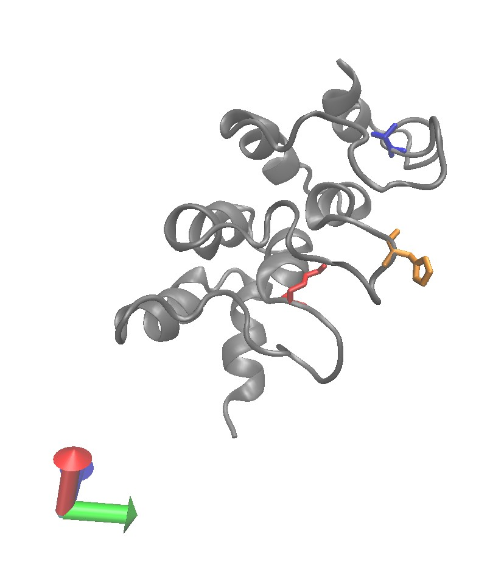
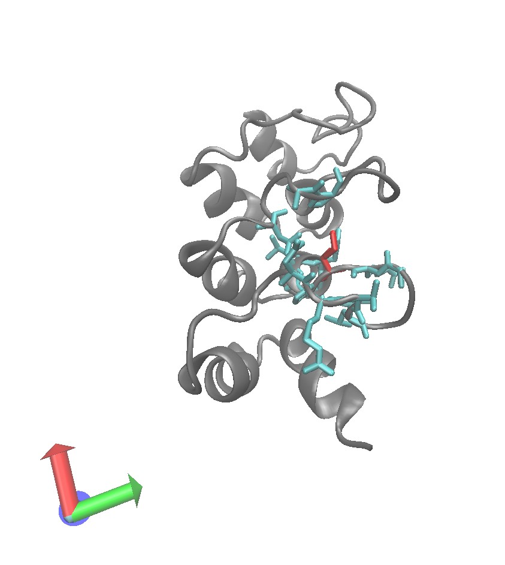
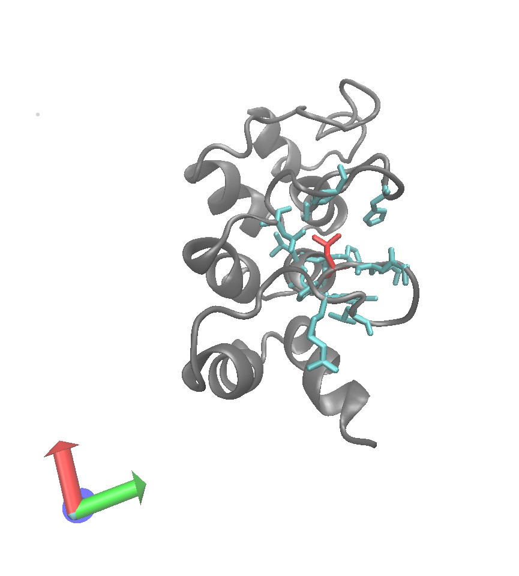
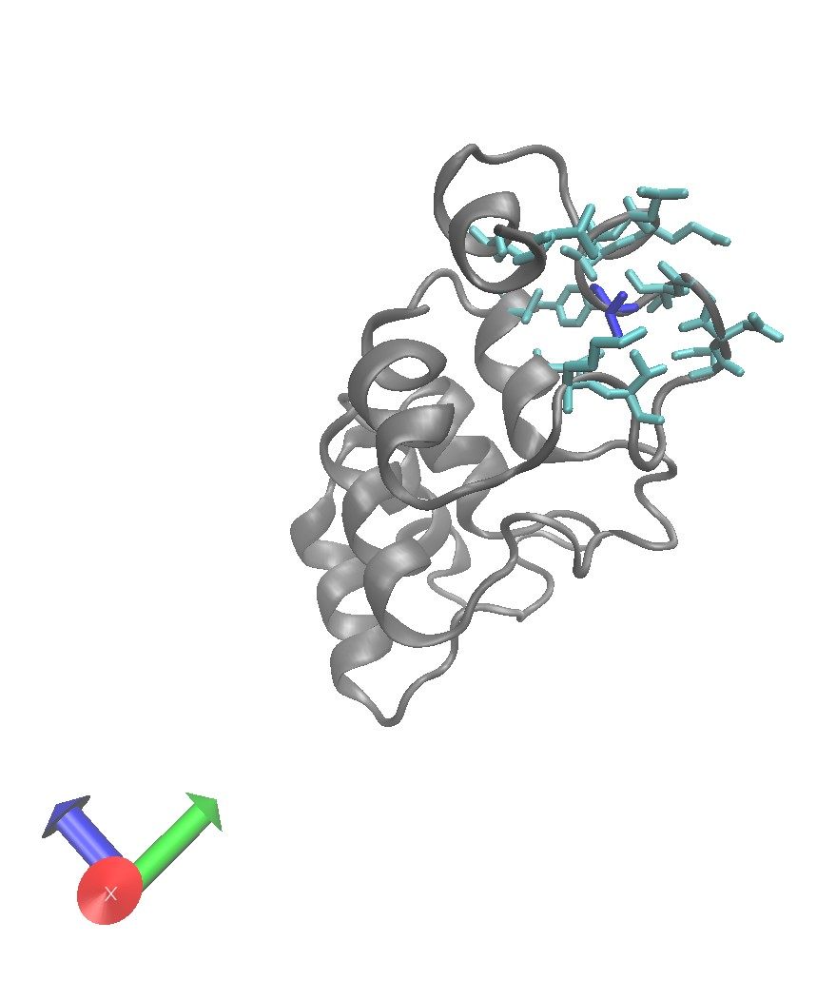
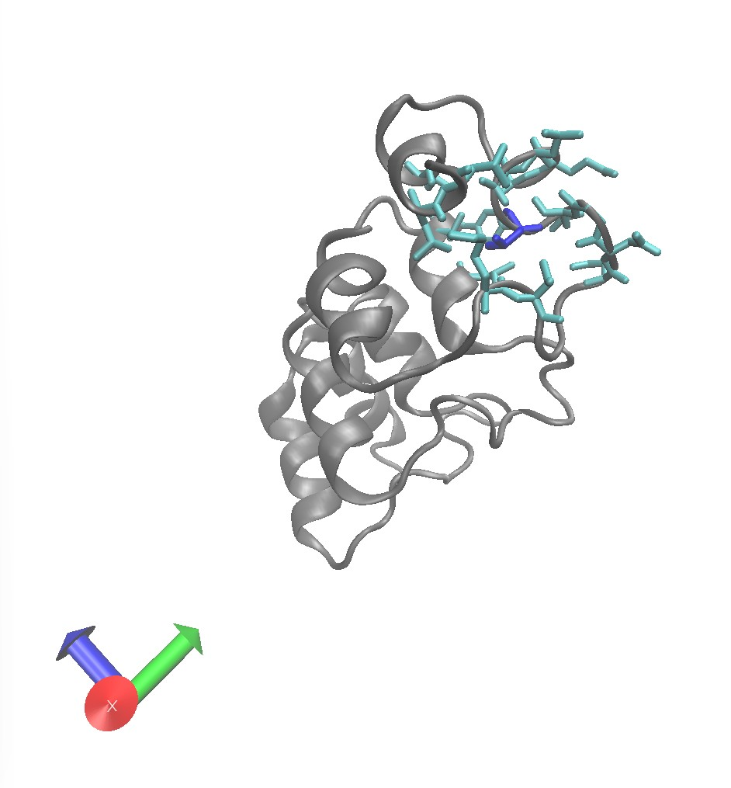
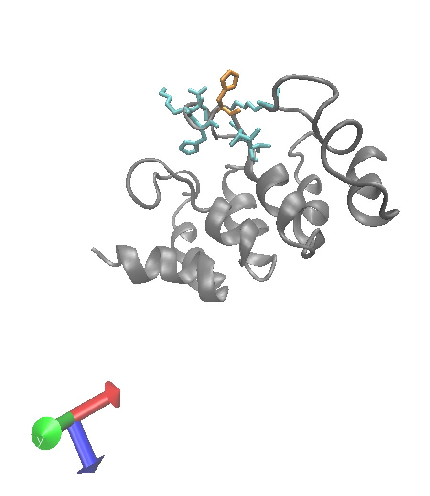
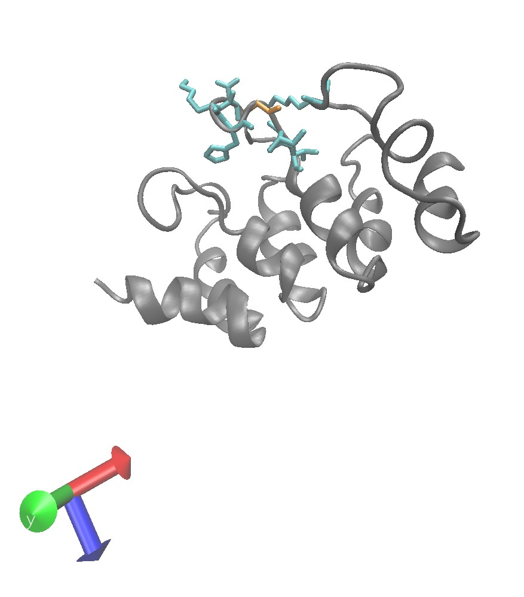

# Mutation hypotheses and screening

## Screening objectives and selection strategy

Following the structural characterization and pilot molecular dynamics simulations of wild-type Myotrophin, computational mutation screening was performed to identify amino acid substitutions potentially capable of improving protein stability.

The previous analyses revealed that Myotrophin undergoes substantial conformational rearrangements at 400 K, accompanied by increased backbone RMSD, solvent exposure, and reduced native-contact retention. Residue-level analysis further identified regions exhibiting elevated fluctuations and reduced preservation of their initial contact environments.

These observations provided a starting point for mutation design. However, local flexibility or native-contact loss does not necessarily imply that replacing a particular residue will improve stability. The effect of a mutation also depends on its chemical properties, structural environment, and interactions with neighboring residues.

Therefore, candidate substitutions were evaluated by combining structural information, wild-type MD results, energetic calculations, evolutionary information, and machine-learning-based stability predictions.

The objective of this stage was to reduce the number of candidate mutations to a manageable set of variants for subsequent MD simulations, while minimizing potentially unfavorable effects on the structural and functional characteristics of Myotrophin.

All residue positions refer to PDB 2MYO, chain A.

## Structural and dynamic basis for candidate selection

Mutation screening was informed by the candidate regions identified during the wild-type characterization.

The first central ankyrin repeat (residues 28–60) exhibited the lowest average residue-level native-contact retention at 400 K. The junction between the two central repeats and the initial C-terminal region also showed substantial structural fluctuations and changes in local interactions.

Three positions were particularly relevant to the subsequent screening:
| Position | Structural context | RMSF at 400 K (Å) | Q_i at 400 K |
| :--- | :--- | ---: | ---: |
| K37 | First ankyrin repeat, adjacent to the 32–36 loop | 2.96 | 0.485 |
| H68 | Second ankyrin repeat, within the 65–69 hairpin-like region | 3.63 | 0.714 |
| T103 | C-terminal region | 3.16 | 0.508 |

K37 and T103 exhibited relatively low native-contact retention, whereas H68 showed substantial fluctuations despite retaining a larger proportion of its initial contacts.

The structural characterization also provided information on local solvent accessibility. K37 and T103 displayed relatively low solvent-accessible surface areas in the experimental structure (16.33 and 14.17 Ų, respectively), while H68 was considerably more exposed (140.35 Ų).

These observations provided a structural and dynamic rationale for further investigating these positions. At this stage, no specific amino acid substitutions could be selected solely from the WT characterization. The choice of replacement residues required additional computational screening, as described in the following sections.

## Functional and structural constraints

Mutation selection also considered the biological function of Myotrophin, particularly its interaction with actin-capping protein.

A supplementary interface-based exclusion criterion was introduced using the Myotrophin–capping protein complex (PDB 3AAA). The repository employed a conservative mask of 24 positions, including residues directly contacting the binding partner and additional protected positions. This mask should be distinguished from a strict set of contacts defined by a 4.5 Å heavy-atom distance threshold.

The first three and last three residues were additionally excluded from the screening as a pragmatic strategy to reduce the influence of terminal regions.

Other substitutions were treated cautiously when they could introduce free cysteine residues, disrupt established helical elements, or interfere with potentially important intramolecular interactions.

These criteria were adopted to prioritize structurally plausible mutations rather than to guarantee preservation of biological function.

# Computational mutation-screening methods

## FoldX energetic screening

FoldX was used to estimate mutation-induced changes in protein stability through an empirical energy function that accounts for van der Waals interactions, hydrogen bonding, electrostatics, solvation, and conformational entropy. For each substitution, the predicted change in folding free energy ($\Delta\Delta G$) was calculated relative to the WT structure, with negative values indicating potentially stabilizing mutations.

Before screening, the experimental 2MYO structure was processed using `RepairPDB`, which optimizes local structural features, particularly side-chain conformations, to obtain a suitable reference model for subsequent energetic calculations.

The resulting `2MYO_Repair.pdb` was used for the mutation screening.

The energetic effect of a mutation was described using:
$$
\Delta\Delta G = \Delta G_{\mathrm{mut}}-\Delta G_{\mathrm{WT}}
$$

Under this convention, negative values indicate predicted stabilization, positive values indicate predicted destabilization, and values close to zero indicate a small predicted energetic effect.

FoldX `PositionScan` was applied to 88 selected residue positions after the structural and functional exclusions. The generated output included standard amino acid substitutions and additional FoldX-specific residue variants.

The resulting predictions were used to identify energetically favorable substitutions and examine their compatibility with the structural observations.

For shortlisted mutations, FoldX `BuildModel` was subsequently employed to generate three-dimensional mutant structures and calculate energetic differences relative to corresponding WT reference models. Five modelling runs were performed for each of 13 selected single-, double-, and triple-mutant variants.

These predictions are estimates produced by the FoldX energy function and do not directly establish experimental changes in melting temperature.

## FireProt 2.0: energetic and evolutionary screening

FireProt 2.0 was used as an additional computational platform for identifying potentially stabilizing mutations by combining structure-based energetic calculations and evolutionary sequence information.

Unlike FoldX, which primarily estimates mutation-induced energetic changes, FireProt integrates complementary mutation-design strategies.

The energy-based approach evaluates amino acid substitutions using empirical energy functions, including FoldX and Rosetta. In the published workflow, FoldX is used for initial energetic screening, while Rosetta provides an additional evaluation of selected candidates. Conservation and evolutionary correlation analyses are also employed to filter potentially unfavorable mutations.

The evolution-based approach, known as back-to-consensus, investigates amino acid frequencies across homologous protein sequences obtained through multiple sequence alignment. Positions where the wild-type residue differs from an evolutionarily preferred residue may be considered for substitution. Candidate consensus mutations are subsequently evaluated using FoldX to assess their predicted energetic compatibility.

FireProt 2.0 also supports ancestral sequence reconstruction as an additional design strategy, although no corresponding results were included in the present analysis.

The exported FireProt dataset contained 2,242 possible single substitutions, including energetic predictions, evolutionary annotations, and indicators identifying mutations selected by the automated design strategies.

Numerical FoldX predictions were available for 950 substitutions, whereas the Rosetta column contained no numerical values. Consequently, Rosetta could not be included as an independent quantitative source in the present screening. The available export alone does not establish whether the Rosetta calculations were skipped, incomplete, or unavailable for another reason.

Seven substitutions were classified as back-to-consensus candidates (isBTC = true), including H68G. Additional mutations were assigned to energy-based or combined design categories.

For example, H68G was supported by a favorable FoldX score and evolutionary consensus criteria. In contrast, K37L and T103L exhibited favorable FoldX predictions in FireProt but were not included in its automatically selected back-to-consensus or energy-based designs.

The FireProt predictions were therefore used as complementary evidence rather than treated as independent confirmation of every shortlisted mutation.

Furthermore, because the platform incorporates FoldX calculations, agreement between the FireProt FoldX scores and the independently performed FoldX PositionScan does not constitute agreement between fully independent energetic methods.

## ThermoMPNN and ThermoMPNN-D

Structure-based machine learning was employed as an additional approach for predicting the effects of amino acid substitutions on protein stability.

ThermoMPNN is a Graph Neural Network developed through transfer learning from ProteinMPNN, a pretrained model that learns relationships between protein sequences and three-dimensional structures.

ProteinMPNN represents the protein using structural information about amino acid residues and their spatial relationships. ThermoMPNN reuses the learned structural representations and combines them with information about the original and substituted amino acids to predict mutation-induced changes in folding stability.

Unlike FoldX, which evaluates mutations using an empirical energy function, ThermoMPNN learns relationships between structural environments and stability changes from experimental training data.

The model produces predicted ΔΔG values, expressed in kcal/mol. In the convention used for the present screening, negative values indicate potentially stabilizing substitutions.

The single-mutation dataset contained 2,242 predictions, corresponding to the 19 possible amino acid substitutions at each of the 118 positions of Myotrophin.

ThermoMPNN-D extends the approach to double-point mutations, allowing the investigation of potentially non-additive effects between substitutions. Such effects, known as epistasis, occur when the combined stability change differs from the sum of the individual mutation effects.

The available double-mutation dataset contained 46,440 predictions involving 143 pairs of residue positions. These pairs were selected using a Cα–Cα distance threshold of 5 Å, focusing the screening on spatially neighboring positions where direct interactions may occur. This distance criterion was used to limit the screened combinations and does not exclude potential long-range effects.

The double-mutation predictions were not simply obtained by summing the values of individual mutations. However, their interpretation as epistatic effects requires considering the predictive limitations of the model and the consistency of the single- and double-mutation calculations.

The ThermoMPNN predictions were compared with FoldX and FireProt to identify agreement or disagreement between computational approaches. Since these methods rely on different modelling principles, consistent predictions provide complementary evidence for mutation selection.

Nevertheless, the predicted values remain computational estimates and do not directly demonstrate improved experimental thermal stability.

# Screening results and candidate mutation hypotheses

The integrated screening identified several potentially favorable substitutions, with K37L, T103L, and H68G receiving particular attention.

To visualize the structural context of these positions, the FoldX-repaired Myotrophin structure was examined in VMD.

As shown in Figure 1, the three positions are distributed across distinct structural regions. K37 belongs to the first central ankyrin repeat, H68 is located in the protruding loop associated with the second repeat, and T103 belongs to the C-terminal region. Their different environments provide the opportunity to investigate alternative mutation-design strategies targeting local packing, polar interactions, and backbone conformational preferences.

The energetic screening results are summarized below:

| Mutation | FoldX PositionScan | FireProt FoldX | ThermoMPNN | FoldX BuildModel (mean ± SD) |
| :--- | ---: | ---: | ---: | ---: |
| K37L | −2.876 | −0.890 | −0.359 | −2.438 ± 0.870 |
| T103L | −1.670 | −1.180 | −0.116 | −1.150 ± 0.143 |
| H68G | −1.736 | −2.330 | +0.029 | −1.730 ± 0.009 |
| D93G | −1.564 | −2.270 | +0.217 | −1.616 ± 0.055 |
| T103F | −2.103 | Not available | −0.313 | −1.976 ± 0.319 |

All predicted energetic changes are reported in kcal/mol. The BuildModel standard deviations describe variability across five modelling runs, not uncertainty derived from independent MD simulations.

For the three main mutation hypotheses, matched wild-type and mutant structures generated by FoldX BuildModel were additionally compared in VMD. In these visualizations, the selected residue and neighboring residues within 5 Å were represented explicitly, while the overall protein backbone was displayed as a gray cartoon.

These static structural comparisons were used to inspect the local changes introduced by each substitution. They should not be interpreted as evidence of improved thermal stability, since they do not characterize the conformational behavior of the mutants during molecular dynamics.

## K37L: modification of the first ankyrin repeat

K37 is located immediately after the protruding loop at residues 32–36, near the beginning of the first central ankyrin repeat's helical framework.

The wild-type simulation showed increased fluctuations at this position and relatively low native-contact retention at 400 K.

Replacing lysine with leucine removes a positively charged side chain and introduces a hydrophobic residue. This substitution could modify local packing and the balance between electrostatic interactions and solvent exposure.

The mutation was predicted to be favorable by FoldX PositionScan, FireProt, and ThermoMPNN. FoldX BuildModel also yielded a negative mean ΔΔG.

However, the WT simulations identified hydrogen-bond interactions between K37 and D60. Their presence does not establish whether they are stabilizing or destabilizing, and the effect of removing the lysine side chain remains a relevant structural consideration.

The local environment of residue 37 was therefore examined in the matched WT and mutant structures.
**(A) Wild Type — K37**

**(B) Mutant — K37L**

*Figure 2. Comparison of the local structural environment of residue 37 in (A) the matched WT and (B) the K37L mutant generated by FoldX BuildModel. The protein backbone is represented in gray, residue 37 in red, and neighboring residues within 5 Å in cyan. Both structures are displayed from comparable orientations.*

Figure 2 shows a clear change in the geometry and spatial extension of the side chain at position 37. In the WT, lysine possesses a relatively long side chain terminating in a positively charged amino group. In the mutant, leucine introduces a shorter, branched hydrophobic side chain occupying a different local volume.

The surrounding residues remain arranged around a similar backbone framework, while the local side-chain environment differs between the two structures. These observations are compatible with the hypothesis that K37L modifies local packing and side-chain interactions. However, the visualization alone does not establish whether the resulting contacts are more energetically favorable or whether the removal of lysine disrupts relevant polar interactions.

K37L was therefore selected as a candidate for subsequent MD validation because of its favorable energetic predictions and its location within a dynamically affected region, rather than because a specific destabilizing interaction had been conclusively identified.

## T103L: modification of the C-terminal region

T103 belongs to the initial C-terminal region, which exhibited substantial conformational fluctuations during the 400 K simulation.

The residue showed a relatively low Qᵢ value and limited solvent accessibility in the experimental structure.

Substitution with leucine introduces a larger hydrophobic side chain, potentially altering local packing and hydrophobic interactions.

FoldX PositionScan, FireProt, and ThermoMPNN all predicted a favorable energetic effect, although the predicted magnitude differed among methods.

The FoldX BuildModel calculations supported a negative mean ΔΔG for T103L.

Nevertheless, threonine contains a hydroxyl group capable of participating in hydrogen bonding. The wild-type analysis identified a T103–D100 interaction whose occupancy decreased substantially at elevated temperature. Replacing threonine with leucine removes this potential hydrogen-bonding functionality.

Thus, the proposed stabilizing mechanism involves a possible trade-off between hydrophobic packing and polar interactions.

**(A) Wild Type — T103**

**(B) Mutant — T103L**

*Figure 3. Comparison of the local structural environment of residue 103 in (A) the matched WT and (B) the T103L mutant generated by FoldX BuildModel. The protein backbone is shown in gray, residue 103 in blue, and neighboring residues within 5 Å in cyan.*

As illustrated in Figure 3, the substitution changes the side-chain geometry at position 103 while preserving the overall backbone arrangement in the displayed models. The leucine side chain differs in volume and orientation from the original threonine, thereby modifying its spatial relationship with surrounding residues.

An important chemical consequence is the loss of the threonine hydroxyl group, which can participate in hydrogen bonding. At the same time, the hydrophobic character of leucine could favor interactions with nonpolar neighboring residues.

The structural comparison therefore illustrates the proposed trade-off between polar interactions and hydrophobic packing. However, the images do not directly demonstrate the formation of more favorable contacts, nor do they establish the energetic consequences of removing the threonine hydroxyl group. These effects require further analysis of interatomic distances and interaction patterns.

T103L was selected for subsequent validation on the basis of its favorable screening results and the structural behavior observed in the C-terminal region.

The alternative T103F, which received favorable predictions from FoldX and ThermoMPNN, remains relevant for further investigation, although the potential steric effects of introducing an aromatic side chain require consideration.

## H68G: backbone-conformation hypothesis

H68 is located within the protruding hairpin-like region associated with the second central ankyrin repeat.

The experimental structure identifies H68 among residues exhibiting unusual backbone torsion angles. Replacing histidine with glycine could be compatible with backbone conformations that are less favorable for larger amino acids.

H68G was also identified as a back-to-consensus candidate by FireProt, providing an evolutionary motivation for investigating this substitution.

FoldX predicted a favorable energetic effect, whereas ThermoMPNN returned a value close to zero.

Unlike K37 and T103, H68 retained a relatively high fraction of its reference contacts during the 400 K simulation. However, it exhibited substantial positional fluctuations.

Because H68 is adjacent to the functionally relevant region surrounding I69, a structural change at this position could also affect the local geometry of the protein–protein interaction surface.

The local structural environment was examined by comparing the matched WT model with the H68G mutant.

**(A) Wild Type — H68**

**(B) Mutant — H68G**

*Figure 4. Comparison of the local structural environment of residue 68 in (A) the matched WT and (B) the H68G mutant generated by FoldX BuildModel. The protein backbone is shown in gray, residue 68 in orange, and neighboring residues within 5 Å in cyan.*

Figure 4 highlights the principal structural consequence of H68G: the removal of the relatively bulky imidazole-containing side chain of histidine. In the mutant, glycine lacks a side chain beyond its hydrogen atom, substantially reducing the volume occupied at this position.

The overall loop backbone appears essentially unchanged between the matched WT and mutant models. Consequently, this static comparison does not demonstrate that the mutation produces a more favorable backbone conformation or relieves the unusual torsion angles identified in the experimental structure.

Nevertheless, the smaller size and greater conformational freedom associated with glycine provide a plausible structural rationale for investigating this substitution. The potential benefit must be balanced against the possibility that increased flexibility could destabilize the local structure or modify the geometry of the nearby functional interface.

H68G was therefore retained as a secondary candidate representing a distinct mutation-design strategy, based on evolutionary information and backbone geometry rather than primarily on low native-contact retention.

## Interpretation of the structural comparisons

Taken together, Figures 2–4 illustrate three different local structural changes introduced by the selected substitutions.

K37L replaces a charged side chain with a hydrophobic one, potentially modifying local packing and electrostatic interactions. T103L replaces a polar residue with a larger hydrophobic side chain, introducing a possible trade-off between hydrogen bonding and nonpolar packing. H68G removes a bulky imidazole group from a loop region, potentially altering conformational preferences.

In all three comparisons, the overall protein backbone remains visually similar between the matched WT and mutant structures. This is consistent with the limited local structural optimization performed during FoldX modelling and should not be interpreted as evidence that the mutations preserve the native fold under thermal stress.

The structural visualizations therefore complement the energetic predictions by making the chemical changes introduced at each site more interpretable. Their stabilizing or destabilizing consequences remain hypotheses to be investigated through subsequent molecular dynamics simulations.

# Multiple-point mutations and energetic additivity

To investigate whether favorable single substitutions could be combined, FoldX BuildModel was used to construct several double and triple variants.

The main combination considered was K37L+T103L, which introduces substitutions in separated structural regions.

The predicted mean ΔΔG values were:

| Variant | FoldX BuildModel ΔΔG (kcal/mol) |
| :--- | ---: |
| K37L | −2.438 ± 0.870 |
| T103L | −1.150 ± 0.143 |
| K37L+T103L | −3.652 ± 0.656 |

The departure from additivity was estimated as:

$$
\Delta\Delta\Delta G =
\Delta\Delta G_{\mathrm{double}} -
\left(
\Delta\Delta G_{\mathrm{single,1}} +
\Delta\Delta G_{\mathrm{single,2}}
\right)
$$

For K37L+T103L, the resulting coupling term was approximately −0.064 kcal/mol.

This is consistent with an approximately additive effect within the FoldX model, although it does not exclude more complex interactions during molecular dynamics or under experimental conditions.

The double mutant was consequently considered a suitable candidate for investigating whether combining substitutions at distinct positions leads to improved native-structure retention.

Additional combinations, including K37L+H68G and K37L+H68G+T103L, were constructed and screened but were not automatically prioritized solely on the basis of their energetic scores.

# Mutation shortlist and transition to MD validation

The screening results support a focused comparative study involving the following molecular systems:
| System | Purpose |
| :--- | :--- |
| WT | Reference system |
| K37L | Evaluate the effect of a substitution within the first central ankyrin repeat |
| T103L | Evaluate the effect of a substitution within the C-terminal region |
| K37L+T103L | Investigate their combined structural effect |

H68G may be considered as an additional candidate if computational resources permit, while T103F remains an alternative substitution at position 103 requiring further structural comparison.

The final selection balances energetic predictions, structural context, consistency between computational methods, and the ability to interpret the effect of each mutation independently.

These predictions do not establish that any of the proposed variants possesses a higher experimental melting temperature.

The subsequent stage will therefore compare the structural behavior of the WT and selected mutants under matched MD conditions, focusing primarily on native-contact retention and complementary structural observables.

# Limitations of the screening approach

Several limitations should be considered when interpreting the results.

First, energetic calculations are based on empirical or learned models and are sensitive to structural preparation and the conformational representation of the protein.

Second, the initial 2MYO structure is a single NMR-derived model, which does not represent the full conformational ensemble accessible to Myotrophin.

Third, the WT MD trajectories used to identify candidate regions were short exploratory simulations, with limited independent sampling.

Finally, agreement between computational methods does not guarantee improved experimental stability or preservation of biological function.

The screening results should therefore be interpreted as testable mutation hypotheses, whose structural consequences will be investigated through comparative molecular dynamics simulations.